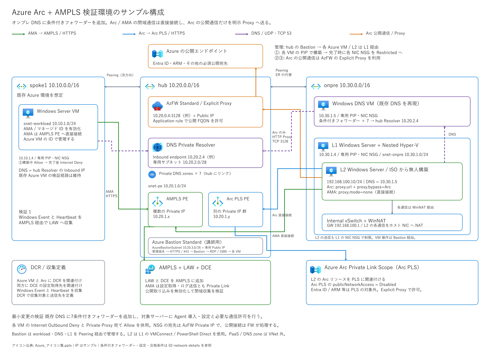

# Azure Monitor Private Link と Azure Arc Private Link ハンズオン



Azure Monitor Private Link と Azure Arc Private Link を使用し、Azure VM とオンプレミスの Windows Server からのログ収集を行うハンズオンです。
基本的には Azure Portal を中心に操作し、Windows 内の設定と Portal だけでは設定できない項目に PowerShell / Azure CLI を使用します。

- ① : Azure 上に疑似オンプレミス環境を用意する章です。すでに環境があれば skip できます。
- ② : Azure VM からのログ収集のハンズオンを行う章です。
- ③ : オンプレミスマシンのログ収集のハンズオンを行う章です。

## 資料を取得する
Private リポジトリを使用する場合、閲覧権限のある GitHub アカウントで取得してください。Git を使わない場合は「Code → Download ZIP」で取得して展開できます。管理端末の PowerShell では次を使用します。

```powershell
git clone https://github.com/uedait/ampls-arcpls-handson.git
Set-Location .\ampls-arcpls-handson
```

以降の管理端末用コマンドは、このフォルダーを基準とします。Windows サーバー内の操作は各章で実行場所を分けて示します。

## 進め方

| 章 | 内容 | 対象 |
|---|---|---|
| [事前確認](docs/prerequisites.md) | 権限、入力値、費用、既存 DNS / AMPLS への影響と変更承認 | 全員 |
| [構成と通信](docs/architecture.md) | 直接接続と Proxy の使い分け、必要な変更 | 全員 |
| [① 任意の検証環境準備](docs/01-lab.md) | 3 VNet、AzFW、Bastion、Resolver、3 VM の PIP・NSG、ISO からの Nested VM 構築と送信制限 | 講師・検証者 |
| [② Azure VM の登録](docs/02-azure.md) | LAW、DCE、AMPLS、PE、Private DNS、DCR、AMA | 既存 Azure 環境の担当者 |
| [③ オンプレミスの登録](docs/03-onpremises.md) | Arc PLS、条件付きフォワーダー、Proxy、Arc、AMA | オンプレミスと Azure の担当者 |
| [結果の確認](docs/validation.md) | ログ、接続先、否定試験、結果記録 | 全員 |
| [障害調査](docs/troubleshooting.md) | DNS、Agent、Proxy、ログ到着の切り分け | 必要な場合 |
| [後片付け・切り戻し](docs/cleanup.md) | 今回の変更だけを戻す手順 | 全員 |

[DNS・Agent 設定と確認項目](docs/images/02-network-details.png)も参照してください。図の編集用正本は [Excalidraw](docs/images/01-architecture.excalidraw) です。[全体構成の SVG](docs/images/01-architecture.svg) と[詳細の Excalidraw](docs/images/02-network-details.excalidraw)・[SVG](docs/images/02-network-details.svg)も用意しています。

## このハンズオンで確かめること

- Azure VM の 監視
  - 1. Azure VM に Azure Monitor Agent（AMA）を導入し、AMPLS の Private Endpoint に直接接続して Windows イベントを収集すること。
- オンプレ VM の監視
  - 2. オンプレミスの VM（※）に Connected Machine Agent（Arc Agent）と AMA を導入し、AMPLS の Private Endpoint に直接接続して Windows イベントを収集すること。
  - 3. オンプレミスの VM（※）の Arc 管理通信が、Arc PLS の専用 Private Endpoint に直接接続すること。
  - 4. オンプレミスの VM（※）の Arc が Entra ID・ARM 等へ行う必要な公開通信を、Arc Agent 固有の Proxy 設定で Azure Firewall（Explicit Proxy）経由のインターネットアクセスとして実現すること。
- 既存環境への影響
  - 5. オンプレミスの DNS（※）に指定した7ドメインの条件付きフォワーダーを追加し、Azure DNS Private Resolver に転送すること。
  - 6. Azure Firewall で指定した FQDN を許可し、Entra ID・ARM 等への必要な公開通信が成功すること。

※ このラボでは、Azure 上に疑似的なオンプレミス環境を用意します。

## 始める前に

- 実施者は、既存ネットワーク全体の変更許可とは別に、検証対象 VM、DNS、Firewall の変更許可を取得してください。まず業務負荷のない対象で実施します。
- 既存 AMPLS、Private DNS zone、条件付きフォワーダーがある場合は、その設定を確認してから進めます。同じ DNS 解決範囲に AMPLS を追加すると、既存の監視に影響することがあります。
- 本編では Azure リソースの作成・変更と課金が発生します。予算、通貨、有効期限、削除担当を決め、実施環境の費用見積もりと変更承認を取得してください。
- 初回導入ファイルの取得、稼働中の Agent 通信、更新時の通信を別々に確認してください。インストーラーの取得にはダウンロード処理の Proxy 指定、導入後の Arc 通信には Agent 固有の Proxy 設定を使用します。
- ①の講師用ラボでは hub の Azure Bastion Standard から各 Azure VM を操作します。L2 は L1 の VMConnect / PowerShell Direct 経由で操作してください。Bastion と専用 Public IP の費用も予算に含めます。
- ①の構築中は3台それぞれの PIP で外向き通信を行い、[公式 ISO から L2 を自動構築](docs/iso-build.md)します。①の最後に各 NIC の NSG を Restricted に切り替え、②③は直接の Internet 通信を遮断した状態で実施します。PIP は関連付けたまま維持し、NSG で通信を制御してください。

## 免責
- Hands-on の作成日は `2026-10-27` です。
- 内容は正確性を期してはいますが、内容を保証するものではありません。
- また、仕様、手順、設定個所、Portal 画面などは、今後の更新などによって変わる場合があります。
- 詳細は、公式のドキュメント(Microsoft Learn)も参照して、手順と設定値を確認してください。各章に関連しそうなリンクを記載してあります。
