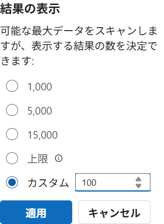
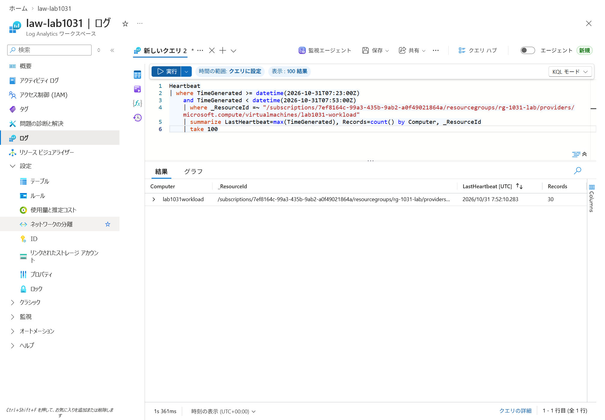

# ② 既存 Azure VM のログを AMPLS 経由で収集する

[README](../README.md) → [事前確認](prerequisites.md) → ② → [③ オンプレミス](03-onpremises.md)

## この章の完了条件

対象 Azure VM の AMA が DCE から設定を取得し、LAW の公開取り込みを無効にした状態で、検証用イベントと Heartbeat が到着します。名前解決と実際の接続先が AMPLS PE の IP であることも確認します。

以下は新規の専用収集リソースを作る手順です。同じ DNS 解決範囲に既存 AMPLS がある場合は、[事前確認](prerequisites.md)で競合と影響を確認し、管理者の承認を得てから進めてください。

①のラボでは workload VM の専用 PIP を維持し、NIC NSG は Restricted の状態で実施します。AMA の初回配布に公開宛先が必要な場合は、配布先と必要な通信を特定して変更を承認してください。配布用の例外は対象・期間を限定し、例外終了後の Restricted 状態で閉域収集の合否を判定します。

### 画面例の環境と撮影方法

画面例は 2026 年 10 月 31 日の Azure Portal で撮影した実画面です。名前は次の専用ラボの値を使用しています。実施時には、作成先、名前、ID、FQDN、観測時刻を承認した環境の値に置き換えてください。

| 対象 | 画面例の値 |
|---|---|
| RG / リージョン | `rg-1031-lab` / Japan East |
| 対象 Azure VM | `lab1031-workload` |
| LAW / DCE | `law-lab1031` / `dce-lab1031` |
| AMPLS / PE | `ampls-lab1031` / `pe-ampls-lab1031` |
| DCR | `dcr-lab1031-windows` |
| hub / PE subnet | `lab1031-hub` / `snet-pe` |

撮影時のリソース作成・設定変更には、承認した構成を保存した Bicep と PowerShell スクリプトを使用しました。Portal の入力例では作成・設定変更を確定するボタンは押していません。作成後の画面では実際の設定を照合しています。VM 内の検証と合成イベント生成には Managed Run Command を使用しました。サインイン画面、パスワード、認証コードは撮影していません。個人情報を含むサブスクリプション表示などはマスクしています。

## 2-1. Log Analytics Workspace を作成する

操作場所は Azure Portal です。

1. 上部の検索で「Log Analytics ワークスペース」を開き、「作成」を選びます。

   

2. 次を指定します。

   | 項目 | 入力 |
   |---|---|
   | サブスクリプション / RG | 事前確認で承認した作業先 |
   | 名前 | `law-lab1031` など、記録した名前 |
   | リージョン | 対象 VM と同じ。例 Japan East |

   

3. 「確認および作成」で費用と入力値を確認し、作成します。

   

4. 作成後の「概要」で Workspace ID と完全なリソース ID を記録します。

   

5. 「使用量と推定コスト」で保持期間、日次上限、取り込みプランを確認します。日次上限に到達すると検証ログも止まるため、ログが到着しない場合は上限の到達状況も確認してください。

   

   

   

6. 「ネットワークの分離 → Public access → 管理」で取り込みの公開アクセスを制限します。画面例では `Ingestion access` を「制限されたパブリック受信、有効なパブリック送信」、`Query access` を「すべてのネットワークから有効」に設定しています。従来の画面では、取り込みの公開アクセスを「無効 / いいえ」にします。作成直後にこの項目が選べない場合は、2-4 の PE 承認後、**AMA を関連付ける前に**設定します。

   

   ARM の設定値では、`publicNetworkAccessForIngestion=Disabled`、`publicNetworkAccessForQuery=Enabled` に対応します。

クエリの公開アクセスは、本ハンズオンでは承認した閲覧端末から Portal の Logs を使える設定を維持します。取り込みとクエリのアクセス設定は個別に確認してください。クエリも閉域にする場合は、閲覧端末に PE の名前解決・接続経路を用意してから変更します。

**確認**: LAW の Provisioning state が Succeeded。作成先とリージョンが記録どおりであること。

## 2-2. Data Collection Endpoint を作成する

1. Portal の検索で「監視」を開き、「設定 → データ収集エンドポイント → 作成」を選びます。「監視」は Azure Monitor の検索名で、画面のタイトルは「モニター」と表示されます。

   

   

2. 作業用 RG、名前 `dce-lab1031`、対象 VM と同じリージョンを指定します。

   

3. プラットフォームを指定する画面では Windows を選択し、作成します。

   

4. DCE の概要にある「構成アクセス エンドポイント」のホスト名を記録します。URL の `https://` や末尾のパスを除いた FQDN を、後で DNS 検証に使用します。

   

DCE は AMA が DCR 等の設定を取得するために必要です。本編の Windows Event の送信先は LAW です。2-6 で DCE を対象 VM の設定取得先として関連付けてください。

**確認**: DCE と VM のリージョンが一致すること。

## 2-3. AMPLS を作成して LAW と DCE を追加する

1. Portal の検索で「Azure Monitor Private Link Scopes」を開き、「作成」を選びます。

   

   

2. サブスクリプション、作業用 RG、名前 `ampls-lab1031` を指定します。
3. 取り込みのアクセスモードを `Private Only` にします。クエリは事前確認の方針に合わせ、このハンズオンの初期値は `Open` とします。

   

   

4. 作成した AMPLS を開き、「Azure Monitor リソース」で「追加」を選びます。

   

5. **LAW と DCE の両方**を追加します。画面例の「範囲の選択」では1件ずつ選ぶため、LAW を選んで適用し、もう一度「追加」から DCE を選んで適用します。対象名とリソース ID を照合します。

   

   

   

AMA の設定取得には DCE、ログ送信には LAW の関連付けを使用します。DCR は 2-6 で対象 VM に関連付けてください。

**確認**: AMPLS の関連付け一覧に LAW と DCE の2件があること。既存の関連付けも作業前の記録どおり維持されていること。

## 2-4. AMPLS の Private Endpoint と DNS を構成する

1. AMPLS の「Private Endpoint 接続」から Private Endpoint を作成します。

   

2. 次を指定します。

   | タブ / 項目 | 入力 |
   |---|---|
   | 基本 | `pe-ampls-lab1031`、hub と同じリージョン |
   | リソース | 作成した AMPLS、サブリソース `azuremonitor` |
   | 仮想ネットワーク | hub VNet、IP に余裕のある PE subnet |
   | DNS | Private DNS zone と統合する |

   

   

   

3. DNS は、次の5 zone と整合する構成にします。既存 zone がある場合は、管理者が承認した zone を選んで統合してください。

   ```text
   privatelink.monitor.azure.com
   privatelink.oms.opinsights.azure.com
   privatelink.ods.opinsights.azure.com
   privatelink.agentsvc.azure-automation.net
   privatelink.blob.core.windows.net
   ```

   

   

4. PE を作成し、接続状態が `Approved`、デプロイが成功したことを確認します。承認待ちなら、リソース所有者に承認を依頼します。

   

5. 各 Private DNS zone の「仮想ネットワーク リンク」で、**Resolver Inbound endpoint がある hub VNet**へのリンクを確認します。リンクの自動登録は無効にしてください。

   

   

   

   

   

6. PE の「DNS の構成」で、FQDN と Private IP の全一覧を記録します。実際に作成された A レコードを各 zone で照合してください。名前解決には DNS zone のレコードを使用します。

   

   

7. AMPLS 側の PE 接続と、LAW / DCE の関連付けが残っていることを確認します。
8. LAW の公開取り込みが無効であることを再確認します。DCE のネットワーク分離でも、Private Link からの設定取得を維持したまま公開アクセスを無効にします。

   DCE の画面例では「ネットワークの分離 → Public access → 管理」で「制限されたパブリック受信、有効なパブリック送信」を確認します。ARM では `networkAcls.publicNetworkAccess=Disabled` に対応します。

   

**確認**: PE は複数の IP を使用します。必要な IP の確保と接続承認の完了を確認してから進んでください。AMPLS の PE には少なくとも /27 の subnet が必要で、このサンプルは /24 を使用します。

## 2-5. Azure VM から名前解決する

1. 専用の対象 Azure VM に、承認された管理接続でサインインします。①の講師用ラボでは、workload VM の「接続 → Bastion」から接続してください。
2. DNS は既存の設計を維持します。任意ラボは Resolver Inbound IP を使用します。お客様環境では、既存 DNS が対象公開ドメインを Resolver へ転送する経路を管理者が用意してください。
3. Windows PowerShell で、記録した実際の値を使用します。

   ```powershell
   Get-DnsClientServerAddress -AddressFamily IPv4
   Resolve-DnsName '<DCE の構成アクセス FQDN>'
   Resolve-DnsName '<Workspace ID>.ods.opinsights.azure.com'
   Test-NetConnection '<DCE の構成アクセス FQDN>' -Port 443
   Test-NetConnection '<Workspace ID>.ods.opinsights.azure.com' -Port 443
   ```

**期待結果**: A レコードの IP が PE 一覧に含まれ、TCP 443 が成功します。CNAME 自体は公開ドメインでも、最終的な A レコードが PE の IP なら想定した解決です。ログの到着は 2-7 で別途確認してください。

画面例の検証では、保存したスクリプトを Managed Run Command で実行し、API の成功とは別にゲストの `executionState=Succeeded` と `exitCode=0` を照合しています。


| 観測対象 | 画面例の実測値 |
|---|---|
| VM の DNS サーバー | `10.20.2.4` |
| DCE の構成アクセス FQDN の最終 A / TCP443 接続先 | `10.20.1.7` / 成功 |
| LAW の ODS FQDN の最終 A / TCP443 接続先 | `10.20.1.5` / 成功 |
| AMA の設定取得接続 | `MonAgentManager.exe`、TCP443、`10.20.1.7` |
| AMA のログ送信接続 | `MonAgentCore.exe`、TCP443、`10.20.1.5` |

AMA の接続は短時間で終了する場合があります。画面例では接続の観測時間を延ばし、両接続の PID を AMA の実行ファイルと照合しました。名前解決と `Test-NetConnection` の成功に加えて、AMA 自身の接続先と 2-7 のログ到着を確認してください。

## 2-6. DCR を作成し AMA と DCE を関連付ける

1. Portal の「モニター → 設定 → データ収集ルール → データ収集ルールの作成」を開きます。

   

2. RG、名前 `dcr-lab1031-windows`、LAW と同じリージョンを指定します。
3. DCE の選択欄で `dce-lab1031` を選びます。画面例では「テレメトリの種類 = Agent-based - Windows or Linux」を選択します。収集するデータ ソースは Windows イベント ログに限定します。従来の画面では「プラットフォームの種類 = Windows」を指定します。項目名が異なる場合は[公式手順](https://learn.microsoft.com/azure/azure-monitor/vm/data-collection)の新旧画面を確認してください。

   

4. 「リソース」で対象 Azure VM を1台だけ追加します。マネージド ID が必要です。新規の専用 VM はシステム割り当て ID を有効にします。既存ユーザー割り当て ID がある VM は、利用先と管理方針を確認して適切な ID を選んでください。

   

   

5. 「データ収集エンドポイント列を表示する」を有効にし、対象 VM の行を選択して「データ収集エンドポイントの編集」から `dce-lab1031` を指定します。従来の画面では「データ収集エンドポイントを有効にする」を使用します。画面にない場合は、作成後に DCE の「リソース → 追加」から対象 VM を関連付けます。

   

6. 「収集と配信 → 新しいデータ ソースを追加」で「Windows イベント ログ」を選択します。「イベント ログ選択モード」を「カスタム」にして次の XPath を入力し、「追加」で一覧へ反映します。

   ```text
   Application!*[System[(EventID=9001) and Provider[@Name='AmplsArcHandson']]]
   ```

   

7. 「宛先 → 宛先の追加」で「Log Analytics ワークスペース」の `law-lab1031` を選びます。収集対象は上記 XPath のイベントに限定してください。

   

   

8. 確認して作成します。Portal は関連付けた対象に AMA がなければ拡張機能を導入します。AMA の導入はこの DCR 関連付けの操作で行います。

   

   

9. 対象 VM の「拡張機能とアプリケーション」で `AzureMonitorWindowsAgent` が Provisioning succeeded になるまで確認します。

   

   

10. DCR の「リソース」と DCE の「リソース」で、それぞれ対象 VM が存在することを確認します。DCR に DCE を記入したことと、**VM に設定取得用 DCE が関連付いていること**は別の確認項目です。

    

    

AMA を明示的に直接接続へ設定します。管理端末の PowerShell 7 で、Azure CLI に対象テナントでサインインし、`az account show` の tenant / subscription を目視でも照合してから実行してください。スクリプトが同じ照合を行い、対象の AMA が存在しない場合は停止します。

Portal で設定取得用 DCE の関連付けが選べない場合は、管理端末で次の補助スクリプトを使用します。別の DCE が既に関連付いている場合は、置き換えず停止します。

```powershell
.\scripts\Set-DceAssociation.ps1 `
  -ExpectedTenantId '<Tenant ID>' `
  -ExpectedSubscriptionId '<Subscription ID>' `
  -ResourceId '<Azure VM の完全なリソース ID>' `
  -DceId '<DCE の完全なリソース ID>'
```

```powershell
.\scripts\Set-AmaDirect.ps1 `
  -ExpectedTenantId '<Tenant ID>' `
  -ExpectedSubscriptionId '<Subscription ID>' `
  -ResourceType AzureVm `
  -ResourceGroup '<Azure VM の RG>' `
  -MachineName '<Azure VM 名>'
```

この設定で Agent は `{"proxy":{"mode":"none"}}` を使用します。スクリプトは既存 settings を取得し、proxy だけを変更して、ほかの設定を維持します。

**確認**: AMA の導入成功、DCR 関連付け、設定取得用 DCE 関連付けの3点を記録してください。これらをそろえてからログの到着を確認します。

## 2-7. 検証用イベントを1件送る

1. 対象 Azure VM で `scripts\Write-HandsonEvent.ps1` を用意します。①の自動構築では VM が取得・検証した同じコミットのソースに含まれるファイルを使用してください。既存環境に配置する場合は、承認された転送手段を使用します。
2. 管理者の Windows PowerShell で実行します。

   ```powershell
   .\Write-HandsonEvent.ps1
   ```

3. 出力された Marker、生成 UTC 時刻、Computer を作業記録に残します。
4. Portal の LAW →「ログ」で、[結果の確認](validation.md)の KQL を実行します。

   「作業モード」を「KQL モード」にします。「表示」の件数は「カスタム → 100」で指定し、KQL にも `take 100` を含めます。今回生成した Marker と対象 VM の `_ResourceId` で絞り込んでください。

   

   画面例では、同じ検証イベントを繰り返し生成せずに結果を撮影するため、検索期間を `2026-10-31 07:23:00〜07:53:00 UTC` の30分に固定しています。実施時には今回の生成 UTC 時刻を含む30分へ置き換えてください。時刻を KQL で指定すると、Portal は「時間の範囲: クエリに設定」と表示します。

   

   

   

   

**期待結果**: 対象 VM の Heartbeat と、Source `AmplsArcHandson` / EventID `9001` / 今回の Marker を含む Event が到着します。初回設定の反映に時間がかかる場合があります。15分を本ハンズオンの初回確認の目安として、到着しなければ時刻を記録して[障害調査](troubleshooting.md)へ進んでください。

公開取り込み Disabled の状態で判定した結果を記録してから③に進んでください。公開取り込みを有効にして判定すると公開経路の通信を閉域収集と誤認するリスクがあるため、その設定で合格としないでください。

## 根拠

- [AMPLS / PE / DNS の構成](https://learn.microsoft.com/azure/azure-monitor/fundamentals/private-link-configure)
- [AMA の Private Link と DCE 関連付け](https://learn.microsoft.com/azure/azure-monitor/fundamentals/private-link-vm-kubernetes)
- [DCR の Portal 作成と AMA 導入](https://learn.microsoft.com/azure/azure-monitor/vm/data-collection)
- [Windows Event と XPath](https://learn.microsoft.com/azure/azure-monitor/vm/data-collection-windows-events)
- [AMA の Proxy 設定](https://learn.microsoft.com/azure/azure-monitor/agents/azure-monitor-agent-network-configuration)
