# ③ オンプレミス Windows Server を Arc PLS と AMPLS に登録する

[README](../README.md) → [② Azure VM](02-azure.md) → ③

## この章で行うこと

オンプレミスの Windows Server を Azure Arc に登録し、②で作成した Log Analytics ワークスペースでログを確認します。次の順に進めます。

1. Azure Arc 用のプライベート エンドポイントを作成し、サーバーから名前解決・接続できるようにします。
2. サーバーを Azure Arc に登録します。Arc の管理通信はプライベート エンドポイントを使い、認証などのインターネット接続が必要な通信は Azure Firewall のプロキシを使います。
3. Azure Monitor Agent を導入し、②の AMPLS のプライベート エンドポイント経由でログを送ります。サーバーの稼働状況を示す Heartbeat と、自分で作成した検証イベントを確認します。

最後に、サーバーがインターネットへ直接接続できない状態でも、Arc の接続とログ収集が続くことを確認します。

本ハンズオンは、同じ VNet / DNS 解決範囲の Arc サーバーがすべて Private Link を使う構成です。Private Link を使わない Arc サーバーも混在させる場合は、共有する DNS の解決結果が通信に影響するため、[公式資料の制約と設計](https://learn.microsoft.com/azure/azure-arc/servers/private-link-security#restrictions-and-limitations)を確認してから構成を決めてください。

### 入力に使う値

①の既定 prefix `arclab` を使う場合の入力例です。②の収集リソースも次の名前で作成したものとして示します。自分が作成したリソース名を使ってください。

| 項目 | ①②の環境の例 | 取得場所 |
|---|---|---|
| サブスクリプション / RG | 承認したサブスクリプション / `rg-arclab-lab` | ②で使った作成先 |
| リージョン | Japan East / コマンドでは `japaneast` | ②で使ったリージョン |
| hub VNet / PE subnet | `arclab-hub` / `snet-pe` | [②の PE 作成](02-azure.md#2-4-ampls-の-private-endpoint-と-dns-を構成する)と同じ |
| Resolver Inbound IP | `10.20.2.4` | Portal で「DNS Private Resolver」を検索 → 対象 Resolver →「受信エンドポイント」→ 対象エンドポイントの IP |
| Windows DNS IP | `10.30.1.5` | 既存 Windows DNS サーバーの IP。①では DNS VM の「概要 → プライベート IP アドレス」 |
| Firewall のプライベート IP | `10.20.0.4` | Portal で「ファイアウォール」を検索 → 対象 Firewall →「概要」 |
| DCE の構成アクセス FQDN | 作成した DCE の値 | [②の DCE 概要](02-azure.md#dce-fqdn) |
| LAW の ODS FQDN と PE IP | 作成した PE の値 | [②の PE の DNS 構成](02-azure.md#law-ods-fqdn) |
| LAW / DCE / DCR | `law-arclab` / `dce-arclab` / `dcr-arclab-windows` | ②で作成したリソース |

## 3-1. Arc Private Link Scope と専用 PE を作成する

操作場所は Azure Portal です。

1. 上部の検索で「Azure Arc Private Link Scopes」を開き、「作成」を選びます。

   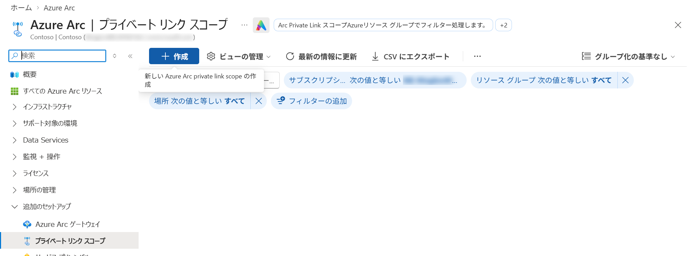

2. サブスクリプション、RG、名前 `arcpls-handson`、リージョン Japan East を指定します。「パブリック ネットワーク アクセスを許可」はオフにします。

   次の画面は入力途中の例です。「Allow public network access」がオンになっているため、チェックを外してから進みます。画像の `rg-1031-lab` は撮影環境の名前です。①の既定値で構築した場合は `rg-arclab-lab` を選びます。

   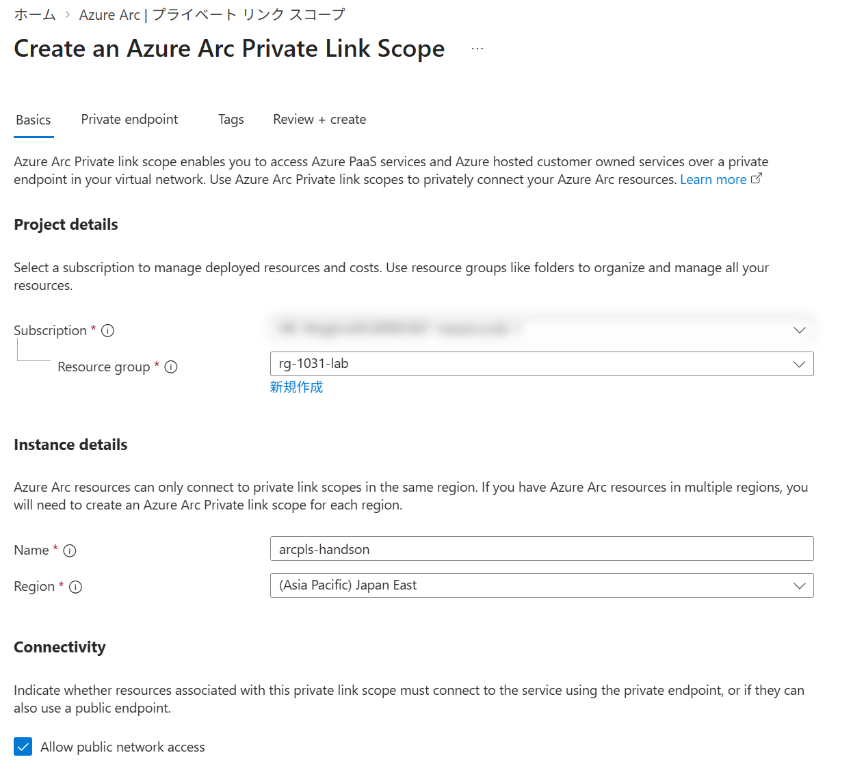

3. 「Private Endpoint」タブで、プライベート エンドポイントの追加を選び、次を指定します。

   | 項目 | 入力例 |
   |---|---|
   | PE のサブスクリプション / RG | ②と同じ作成先 / `rg-arclab-lab` |
   | 名前 | `pe-arc-handson` |
   | リージョン | hub VNet と同じ Japan East |
   | 仮想ネットワーク | ②の AMPLS PE と同じ `arclab-hub` |
   | サブネット | ②と同じ `snet-pe` |
   | プライベート DNS ゾーンと統合する | はい |
   | DNS ゾーンのサブスクリプション / RG | ②と同じ作成先 / `rg-arclab-lab` |
   | 新規作成する DNS ゾーン | `privatelink.his.arc.azure.com`、`privatelink.guestconfiguration.azure.com` |

   既存の承認済み DNS ゾーンがある場合は、それを選択します。AMPLS のゾーンはここでは選びません。

   次の撮影画面では、上記2ゾーンに加えて `privatelink.dp.kubernetesconfiguration.azure.com` も DNS 統合の作成候補として表示されています。画面に表示された候補と作成先 RG を確認します。VNet は撮影環境の `lab1031-hub` ではなく、自分が②で使用した hub VNet を選びます。

   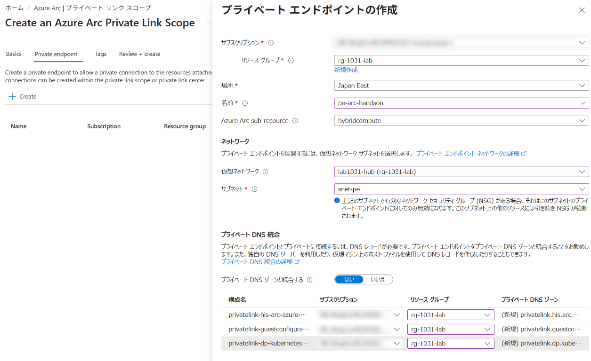

   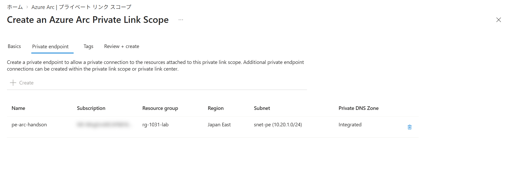

4. PE の入力画面の「OK / 追加」を押して Arc PLS の作成画面へ戻ります。「確認および作成 → 作成」を押し、デプロイの完了を待ちます。PE の入力だけでは、リソース作成は完了していません。

   「Review + create」で `Public network access` が `Disable / Disabled` であることを確認してから「Create」を押します。次の画像は公開アクセスが `Enable` の入力途中の画面です。この状態では「Previous」で基本設定へ戻り、「Allow public network access」のチェックを外してください。画像はデプロイ完了を示すものではありません。

   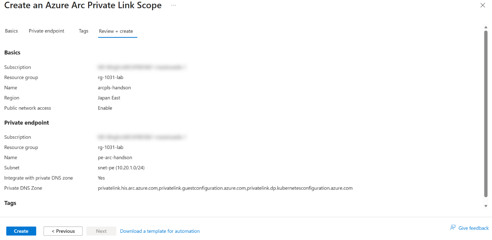

5. Portal の検索で「リソース グループ」を開き、`rg-arclab-lab` → `arcpls-handson` を開きます。「プライベート エンドポイント接続」で `pe-arc-handson` の接続状態が `Approved` であることを確認します。承認待ちの場合は Arc PLS の所有者へ承認を依頼します。

   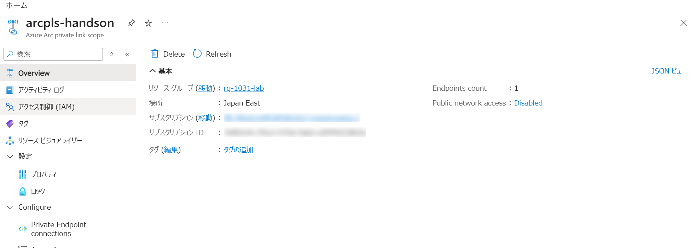

   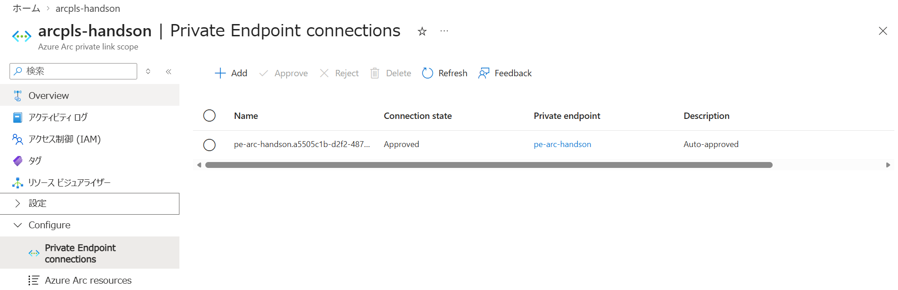

6. 同じ RG から `pe-arc-handson` →「DNS の構成」を開きます。HIS と Guest Configuration の公開 FQDN と、それぞれのプライベート IP を控えます。後のコマンドには `privatelink` 付きの名前ではなく、この画面にある公開 FQDN を使います。

   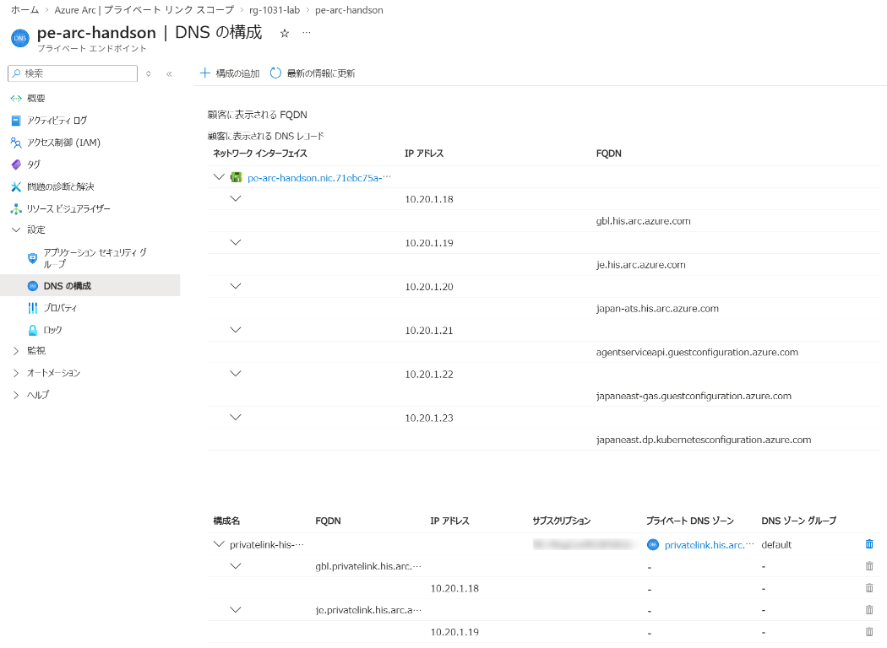

7. Portal の検索で「プライベート DNS ゾーン」を開き、上記2ゾーンをそれぞれ開きます。「仮想ネットワーク リンク」に `arclab-hub` があり、リンク状態が `Completed` であることを確認します。なければ「追加」で hub VNet を選び、「自動登録を有効にする」をオフにして作成します。PE のレコードは DNS 統合で管理するため、VM の名前を自動登録する必要はありません。

   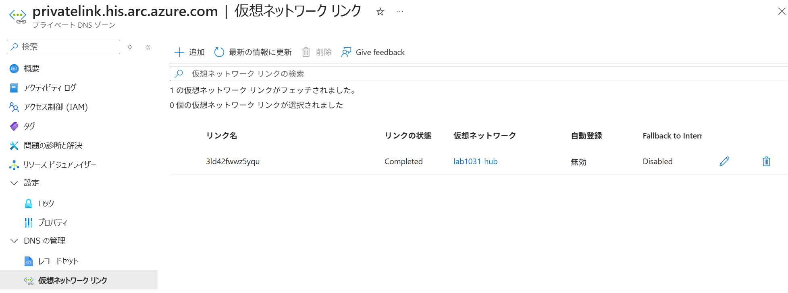

確認: Arc PLS の公開アクセスが無効で、Arc PE が承認済みです。Arc PLS と後で登録する Arc サーバーは同じリージョンを使います。Arc PE と②の AMPLS PE は別のリソースです。

<a id="windows-dns"></a>

## 3-2. Windows DNS に条件付きフォワーダーを追加する

操作場所は既存 Windows DNS サーバーの「DNS マネージャー」です。AD 統合 DNS の設定は複製先にも適用されます。既存のオンプレミス環境を利用する場合、既存の名前解決に影響を与える変更ですので、十分ご注意ください。新規の専用ラボでは次の7件を追加します。

1. 「DNS マネージャー」で対象 DNS サーバー →「条件付きフォワーダー」を右クリックし、「新しい条件付きフォワーダー」を選びます。
2. 次の各行について「DNS ドメイン」と「マスター サーバーの IP アドレス」を入力し、「OK」を押します。7件とも同じ Resolver Inbound IP を指定します。

   | DNS ドメイン | マスター サーバーの IP アドレス |
   |---|---|
   | `his.arc.azure.com` | `10.20.2.4` |
   | `guestconfiguration.azure.com` | `10.20.2.4` |
   | `monitor.azure.com` | `10.20.2.4` |
   | `oms.opinsights.azure.com` | `10.20.2.4` |
   | `ods.opinsights.azure.com` | `10.20.2.4` |
   | `agentsvc.azure-automation.net` | `10.20.2.4` |
   | `blob.core.windows.net` | `10.20.2.4` |

   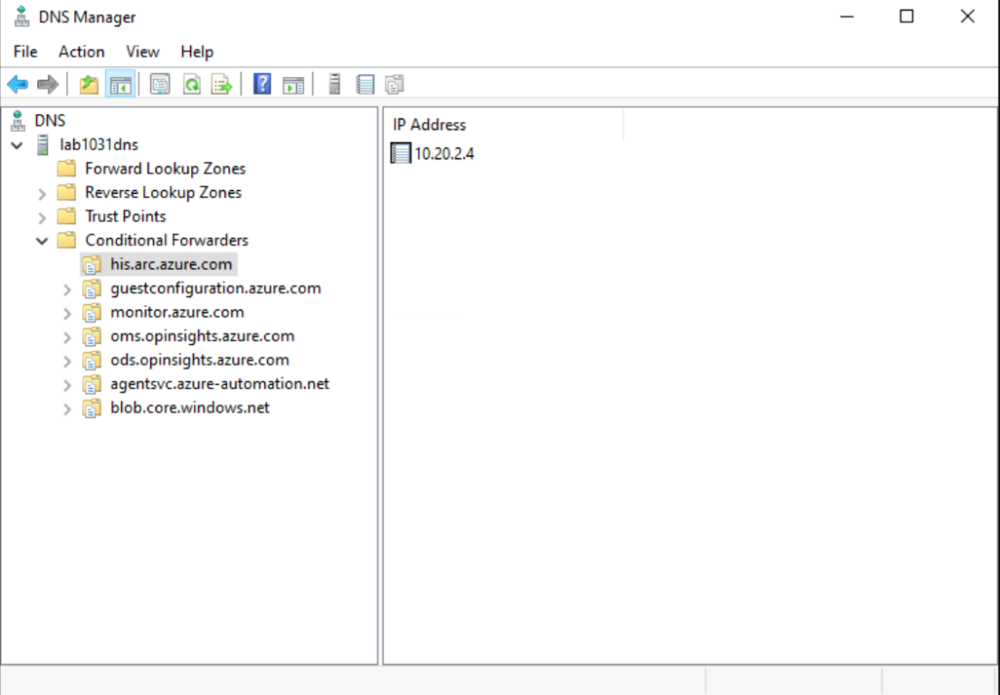

3. Arc を導入するサーバーで Windows PowerShell を開き、次を実行します。

   ```powershell
   Resolve-DnsName gbl.his.arc.azure.com
   Resolve-DnsName japaneast-gas.guestconfiguration.azure.com
   ```

   ここでは、環境によって変化しない代表的な FQDN を使って名前解決を確認していますが、全 FQDN についても同様に確認する場合は、上記の 7 件の条件付きフォワーダーに対応する FQDN を Private DNS ゾーンの Aレコードなどから確認して、順に `Resolve-DnsName` で確認できます。

   `gbl.his.arc.azure.com` の実行結果例です。次は撮影環境で実際に取得した出力で、IP と TTL は環境・実行時刻によって異なります。

   ```text
   PS C:\Users\labadmin> Resolve-DnsName gbl.his.arc.azure.com

   Name                           Type   TTL   Section    NameHost
   ----                           ----   ---   -------    --------
   gbl.his.arc.azure.com          CNAME  1450  Answer     gbl.privatelink.his.arc.azure.com

   Name       : gbl.privatelink.his.arc.azure.com
   QueryType  : A
   TTL        : 10
   Section    : Answer
   IP4Address : 10.20.1.18

   PS C:\Users\labadmin>
   ```

確認: 最終 A レコードの `IP4Address` が、3-1 の Arc PE の「DNS の構成」にある `gbl.his.arc.azure.com` のプライベート IP と一致します。この例では `10.20.1.18` です。

<a id="explicit-proxy"></a>

## 3-3. Azure Firewall の Explicit Proxy を設定する

操作場所は Azure Portal です。①の環境は Firewall Standard を使います。

1. 上部の検索で「ファイアウォール」を開き、対象 Firewall →「概要」でプライベート IP を確認します。関連付けられた Firewall Policy のリンクを開きます。

   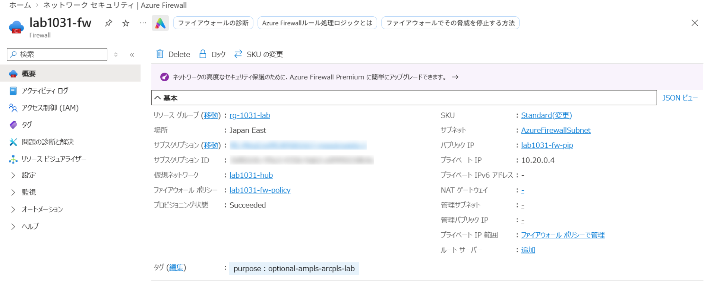

2. Policy の「Explicit Proxy / 明示的なプロキシ」を開き、有効にします。HTTP 待受ポートには使用可能な任意のポート番号を指定します。本ハンズオンは例として `3128` を使い、以降の接続許可と Proxy URL もこの番号で統一します。HTTP と HTTPS は同じ待受ポートを使います。

   Azure Arc の Agent に直接 Proxy URL を指定するため、Proxy PAC は利用しません。「プロキシの自動構成を有効にする」はチェックせず、「保存」を押します。

   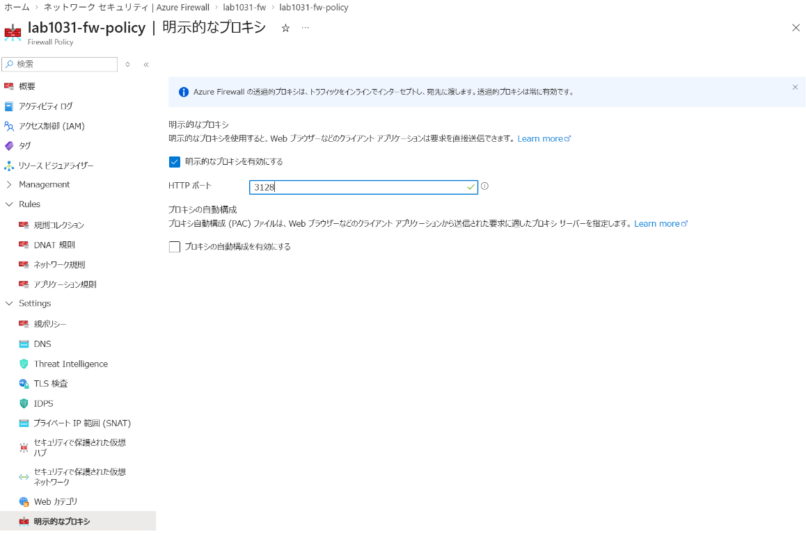

3. Policy の「規則コレクション」から「規則コレクションの追加」を開き、次を入力して「追加」を押します。①の専用ハンズオン環境向けの例です。共有環境では既存の優先度と許可先に合わせ、ソースは対象サーバーの送信元 IP（NAT がある場合は変換後の IP）に限定してください。

   | 規則コレクションの項目 | 入力例 |
   |---|---|
   | 名前 | `arc-public-outbound` |
   | 規則コレクションの種類 | Application |
   | 規則コレクション グループ | `DefaultApplicationRuleCollectionGroup` |
   | 優先度 | `200`。既存コレクションと重複しない値 |
   | アクション | Allow / 許可 |

   コレクション内に次の規則を追加します。すべてソースの種類は「IP アドレス」、ソースは `*`、プロトコルは `HTTPS:443`、宛先の種類は「FQDN」です。

   | 規則名 | 対象 FQDN |
   |---|---|
   | `arc-auth` | `login.microsoftonline.com`,`*.login.microsoft.com`,`pas.windows.net` |
   | `arc-arm` | `management.azure.com` |
   | `arc-notifications` | `guestnotificationservice.azure.com`,`*.guestnotificationservice.azure.com`,`*.servicebus.windows.net` |
   | `arc-download` | `aka.ms`,`download.microsoft.com`,`gbl.his.arc.azure.com` |

   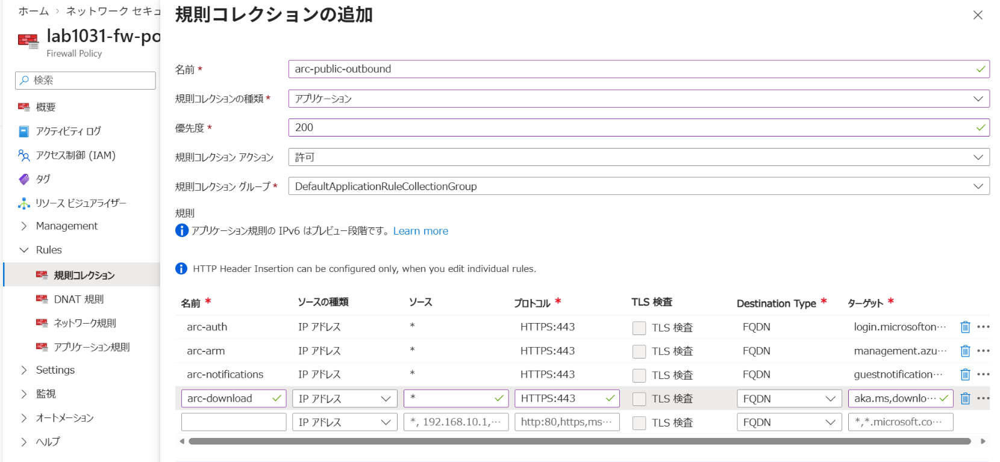

   これは [Arc の公式ネットワーク要件](https://learn.microsoft.com/azure/azure-arc/servers/network-requirements#urls)に基づく例です。ダウンロードの転送先や導入する拡張機能に追加の宛先が必要な場合は、失敗した接続先を確認して追加します。Arc の HIS / Guest Configuration と AMA の送信先は PE に直接接続するため、この Proxy 規則には追加しません。
4. Policy の「DNS」を開き、「DNS サーバー」でカスタムを選び、Resolver Inbound IP（例 `10.20.2.4`）を入力して「保存」を押します。DNS Proxy は、このハンズオンでは①の設定を維持します。対象サーバーの DNS は [3-2 の Windows DNS](#windows-dns)を使います。

   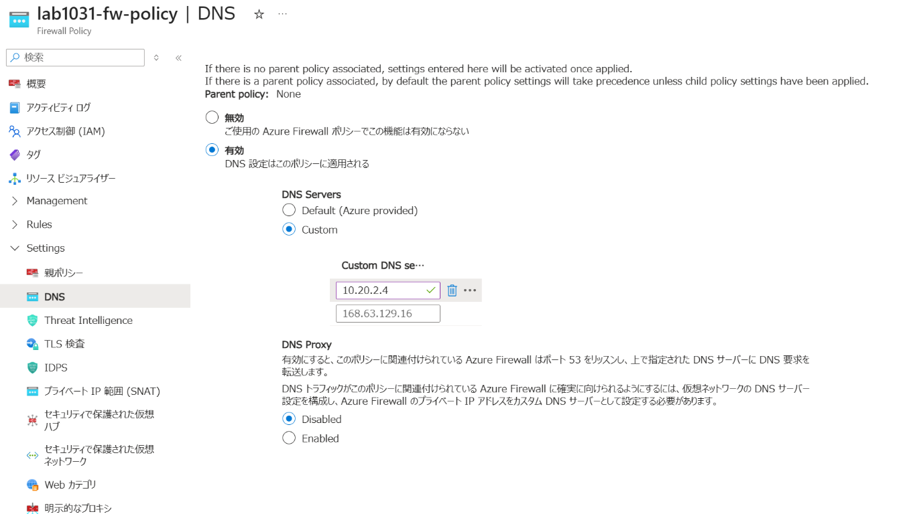

5. Premium を使う場合は、追加した Application 規則を開き、「TLS 検査」をチェックせず保存します。Arc 用の通信は証明書を置き換えません。①の Standard には TLS 検査の設定がないため、この操作は不要です。共有 Policy の TLS 検査全体は変更しません。
6. Firewall 本体の「診断設定 → 診断設定を追加」を開き、Application rule のログを選択します。「Log Analytics ワークスペースに送信する」で②の LAW を指定し、宛先テーブルに「リソース固有」を選んで保存します。ログは `AZFWApplicationRule` に入ります。既に同じ設定があれば追加不要です。診断ログの取り込み費用が発生します。

   次の画像では `allLogs` と「Azure Diagnostics」が選択されています。本手順の後半の KQL は「リソース固有」の `AZFWApplicationRule` を使うため、同じ KQL を使う場合は「リソース固有」を選んで保存してください。「Azure Diagnostics」を維持する場合は `AzureDiagnostics` テーブル用の KQL が必要です。本手順の `AZFWApplicationRule` 用 KQL はそのまま使えません。

   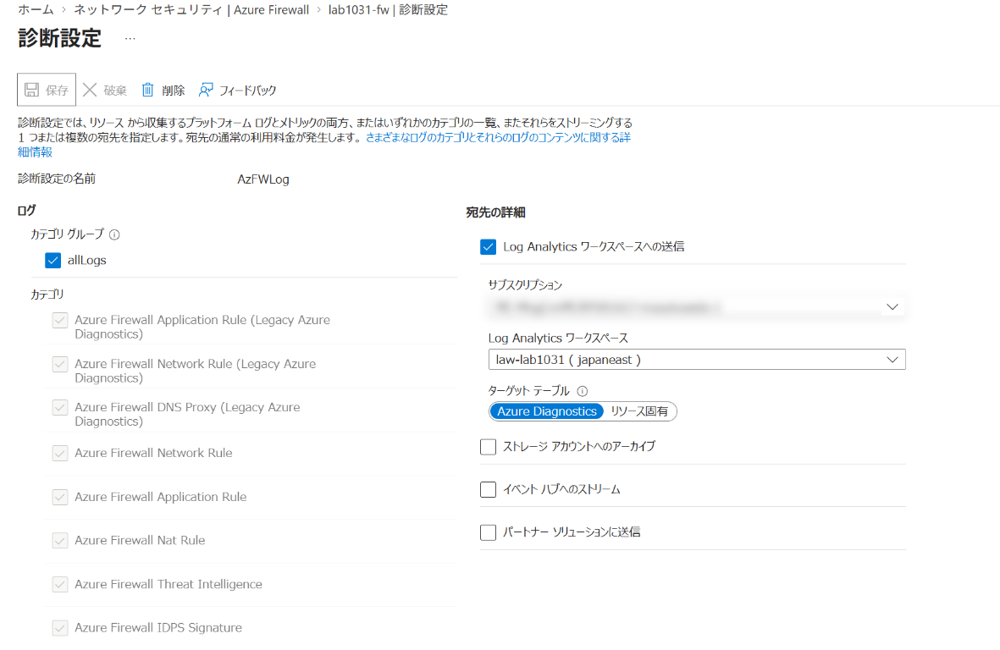

7. ここまでで設定した Azure Firewall をプロキシとして使い、Arc を導入するサーバーから HTTPS 通信ができることを確認します。対象サーバーの Windows PowerShell で次を実行します。

   ```powershell
   $proxyIp = '10.20.0.4'
   $proxyPort = 3128
   $proxyUrl = "http://${proxyIp}:$proxyPort"
   Test-NetConnection $proxyIp -Port $proxyPort
   $response = Invoke-WebRequest -UseBasicParsing `
       -Uri 'https://management.azure.com/metadata/endpoints?api-version=2020-06-01' `
       -Proxy $proxyUrl -ErrorAction Stop
   $response.StatusCode
   ```

   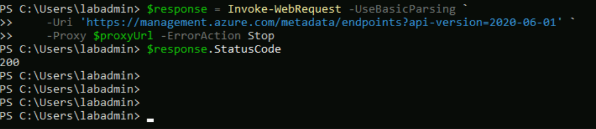

確認: `TcpTestSucceeded` が `True`、HTTP ステータスが `200` です。これは Proxy 経由の HTTPS 疎通確認であり、Arc の認証確認は次の登録操作で行います。

<a id="arc-onboarding"></a>

## 3-4. Azure Portal から Arc に登録する

1. 管理端末の Azure Portal で「Azure Arc」を検索し、「インフラストラクチャ → マシン → オンボード / 作成 → 既存マシンのオンボード」を開きます。
2. 「基本」で次を指定します。

   | 項目 | 入力例 |
   |---|---|
   | サブスクリプション / RG | 承認した作成先 / `rg-arclab-lab` |
   | リージョン | Arc PLS と同じ Japan East |
   | オペレーティング システム | Windows |
   | 接続方法 | Private endpoint |
   | Private Link Scope | `arcpls-handson` |
   | Proxy サーバー URL | `http://10.20.0.4:3128` |
   | 認証 | マシンを手動で認証 |

   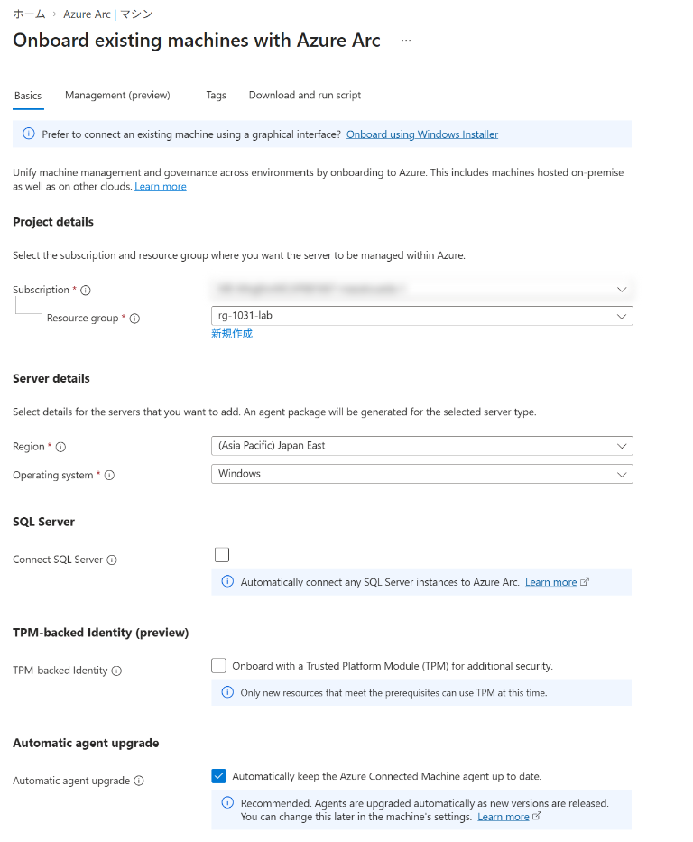

   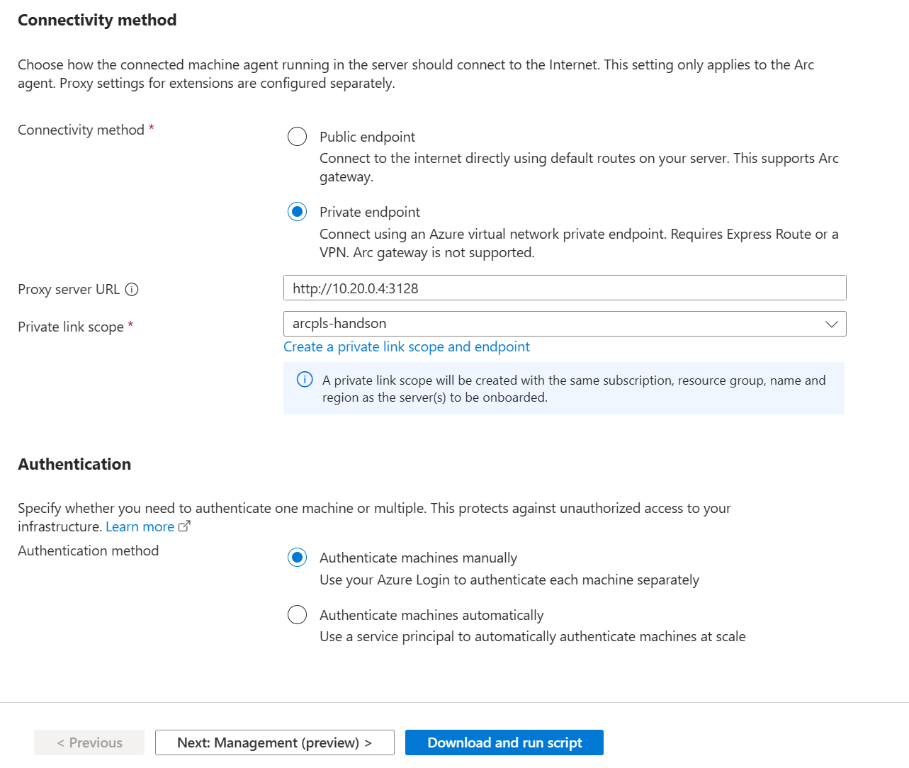

3. 「次へ」で「タグ」を開き、`ArcSQLServerExtensionDeployment` = `Disabled` を追加します。本ハンズオンでは SQL Server 拡張機能を自動導入しません。
4. 「次へ → スクリプトのダウンロードと実行」で作成先と接続方法を確認し、「ダウンロード」を押します。Microsoft が生成する `OnboardingScript.ps1` を対象サーバーの任意の作業フォルダー（例 `C:\ArcOnboarding`）へ配置します。①でも L1 ではなく L2 へ配置してください。

   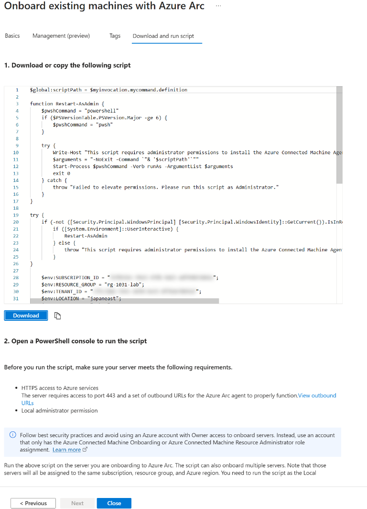

5. ダウンロードした `OnboardingScript.ps1` をエディターで開き、次の3箇所を確認・編集します。2026年11月4日に Portal で生成したファイルを例にしています。

   - **マシン全体の Proxy 設定**: `SetEnvironmentVariable` を検索します。該当する行がないことを確認します。万一、ファイルに `HTTPS_PROXY` を `Machine` に保存する行がある場合は、その行を削除します。既存の OS の Proxy 設定を変更しないためです。
   - **ダウンロードとインストール**: `# Download the installation package` と `# Install the hybrid agent` を検索します。それぞれの直後のコマンドに、次のように `-proxy "http://10.20.0.4:3128"` が付いていれば変更不要です。

     ```powershell
     # Download the installation package
     Invoke-WebRequest -UseBasicParsing -Uri "https://gbl.his.arc.azure.com/azcmagent-windows" -TimeoutSec 30 -OutFile "$installScriptPath" -proxy "http://10.20.0.4:3128";

     # Install the hybrid agent
     & "$installScriptPath" -proxy "http://10.20.0.4:3128";
     ```

   - **登録後も使う Arc Agent の Proxy 設定**: ダウンロード・インストールの `-proxy` だけでは、稼働する Agent の通信経路を設定したことにはなりません。`proxy.url` は認証・ARM 等の公開通信に Firewall のプロキシを使う設定、`proxy.bypass=Arc` は HIS / Guest Configuration に PE へ直接接続する設定です。直接インターネットへ接続できる環境では追加せずに動く場合もありますが、本ハンズオンの通信経路には両設定が必要です。既に同じ Agent 設定がある場合は追加不要です。

     `# Run connect command` を検索し、その直前の `Start-Sleep -Seconds 5;` との間に次を追加します。画像では59行目の待機処理の後、60行目以降が追加位置です。行番号は生成ファイルによって異なるため、コメントを目印にします。元の `connect` コマンドは変更せず残してください。

     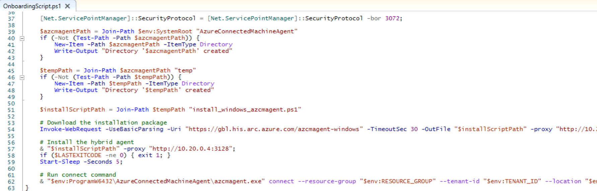

     ```powershell
     Start-Sleep -Seconds 5;

     $arc = "$env:ProgramW6432\AzureConnectedMachineAgent\azcmagent.exe"
     & $arc config set proxy.url 'http://10.20.0.4:3128'
     if ($LASTEXITCODE -ne 0) { throw 'Arc proxy setup failed.' }
     & $arc config set proxy.bypass 'Arc'
     if ($LASTEXITCODE -ne 0) { throw 'Arc proxy bypass setup failed.' }

     # Run connect command
     ```

     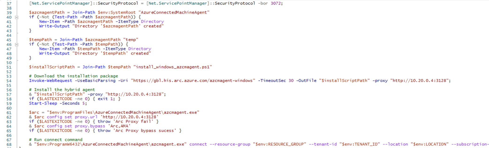

   - **デバイス登録コードでの登録**: スクリプトそのままでは、Agent は直接インターネット疎通による登録を試みます。ハンズオンの環境は、インターネット疎通ができないため、デバイスコード認証で登録するようにスクリプトを修正します。azcmagent.exe ... connect の行に、--use-device-code を追加する必要があります。デバイスコード認証が不可能な場合には、[公式の別認証方法](https://learn.microsoft.com/azure/azure-arc/servers/azcmagent-connect)を確認してください。


6. 対象サーバーの管理者 Windows PowerShell で、ファイルの配置先へ移動して実行します。公式スクリプトが Agent のダウンロード、インストール、Arc 登録を行います。5. でデバイスコード認証を行うよう スクリプトの修正を行っているため、画面に表示された認証 URL を、別のインターネット疎通可能な管理端末で開き、表示されたコードで認証します。

   ```powershell
   Set-Location 'C:\ArcOnboarding'
   .\OnboardingScript.ps1
   ```

   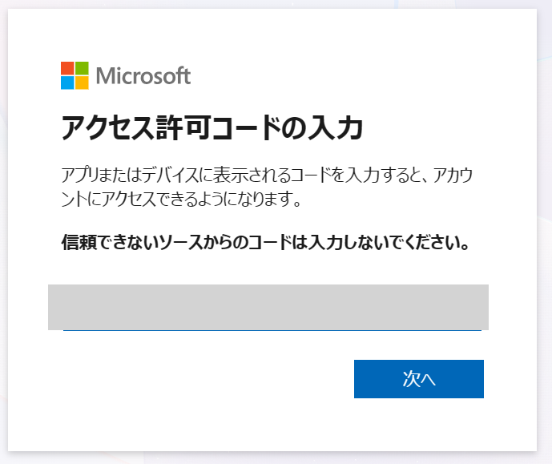

   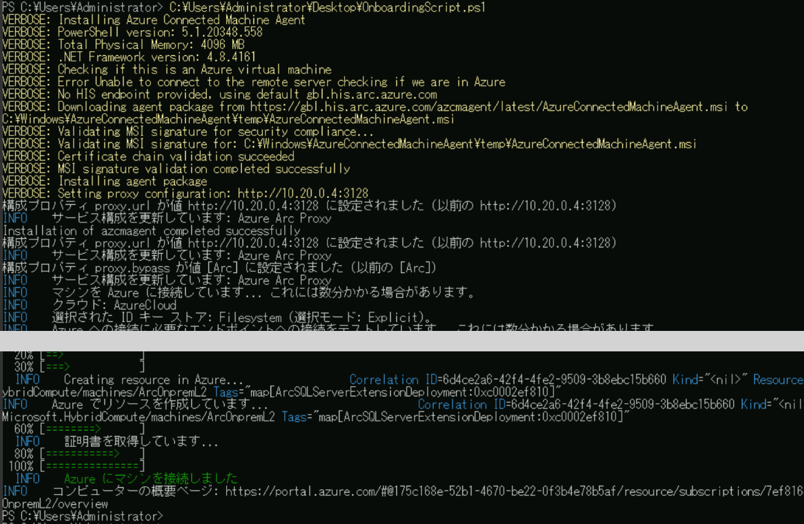

7. Portal の「Azure Arc → インフラストラクチャ → マシン」を開き、登録したサーバーの状態が `Connected` であることを確認します。対象を開いて作成先とリージョンを確認し、「概要 → JSON ビュー」の `id` を控えます。KQL に使うのはこの Arc リソース ID です。

   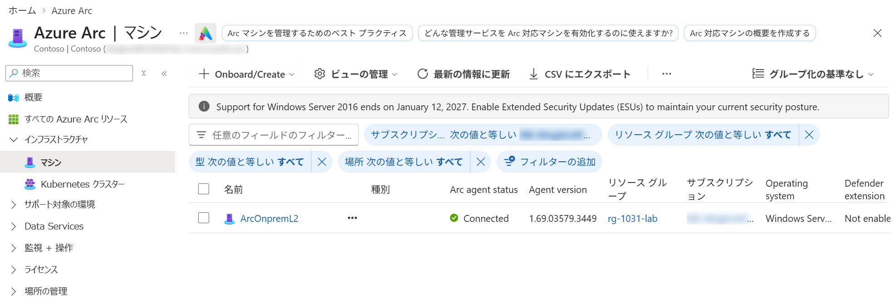

8. 対象サーバーの管理者 Windows PowerShell で次を実行します。

   ```powershell
   $arc = "$env:ProgramFiles\AzureConnectedMachineAgent\azcmagent.exe"
   & $arc show
   if ($LASTEXITCODE -ne 0) { throw 'Arc status check failed.' }
   & $arc check --location japaneast --enable-pls-check
   if ($LASTEXITCODE -ne 0) { throw 'Arc network check failed.' }
   ```

   `azcmagent check` の実行結果例です。

   ```text
   PS C:\Users\Administrator>    & $arc check --location japaneast --enable-pls-check
   INFO    クラウド: AzureCloud
   INFO    Azure への接続に必要なエンドポイントへの接続をテストしています...これには数分かかる場合があります。
   ユース ケース  |エンドポイント                                               |到達可能  |プライベート   |TLS      |プロキシ
   core     |https://agentserviceapi.guestconfiguration.azure.com  |true  |true     |TLS 1.3  |bypassed
   core     |https://gbl.his.arc.azure.com                         |true  |true     |TLS 1.2  |bypassed
   core     |https://japaneast-gas.guestconfiguration.azure.com    |true  |true     |TLS 1.3  |bypassed
   core     |https://je.his.arc.azure.com                          |true  |true     |TLS 1.2  |bypassed
   core     |https://login.microsoftonline.com                     |true  |unknown  |TLS 1.3  |set
   core     |https://management.azure.com                          |true  |unknown  |TLS 1.3  |set
   core     |https://pas.windows.net                               |true  |unknown  |TLS 1.3  |set
   ```

   この例では、HIS / Guest Configuration は「到達可能」と「プライベート」が `true`、プロキシが `bypassed` です。認証・ARM 等の公開宛先は「到達可能」が `true`、プロキシが `set` です。公開宛先の「プライベート」欄の `unknown` を、到達失敗とは扱いません。

確認: 有効な Proxy URL が指定どおりで、bypass が `Arc` です。ネットワークチェックでは HIS / Guest Configuration が Private Endpoint を使い、認証・ARM 等の必須チェックも成功します。

<a id="arc-monitoring"></a>

## 3-5. AMA と DCR / DCE を関連付けてログを確認する

1. Portal で「監視」を検索し、「設定 → データ収集ルール」から②の `dcr-arclab-windows` を開きます。「リソース → 追加」で登録した Arc サーバーを選び、「適用」を押します。Portal が AMA を導入します。

   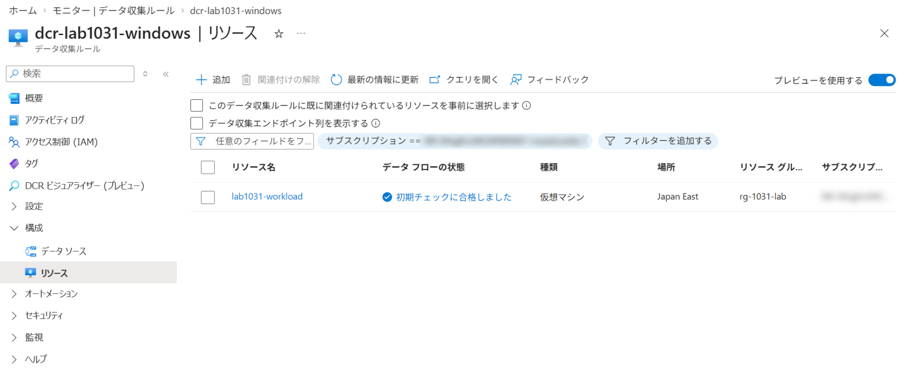

   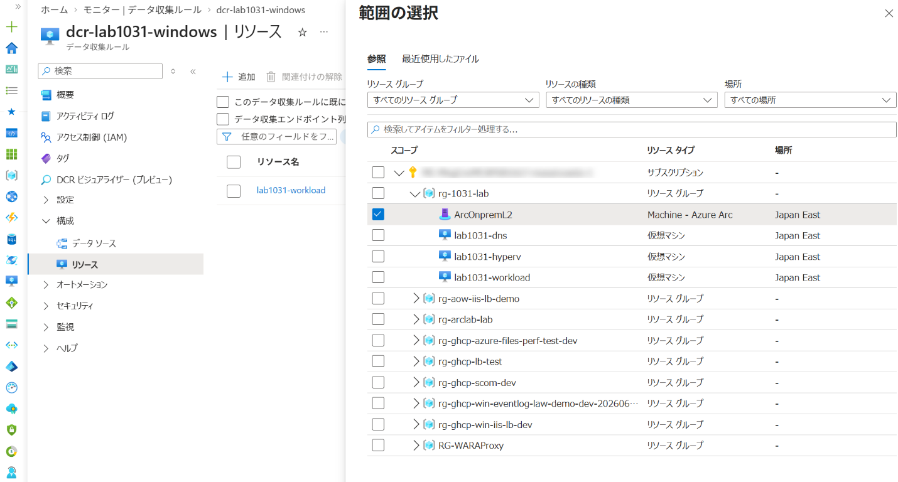

   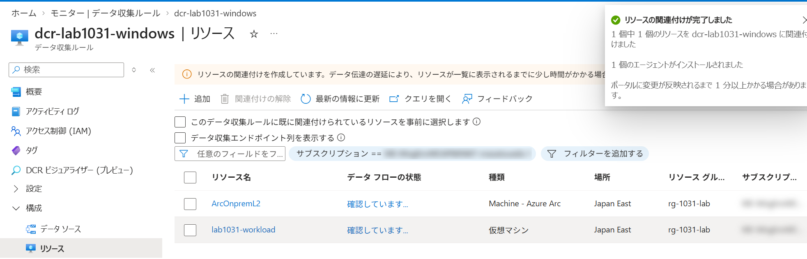

2. Arc サーバーの「拡張機能」で `AzureMonitorWindowsAgent` のプロビジョニング状態が `Succeeded` になるまで待ちます。

   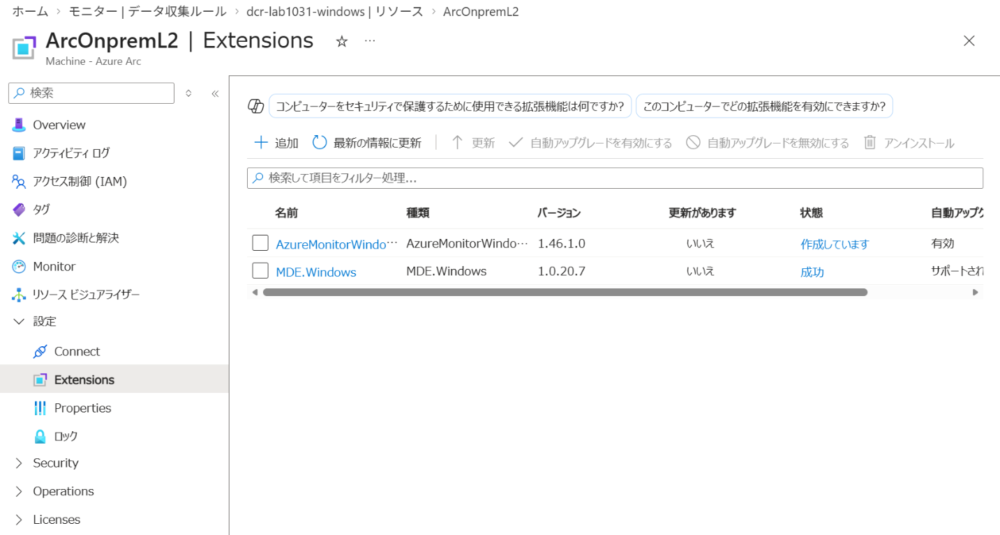

   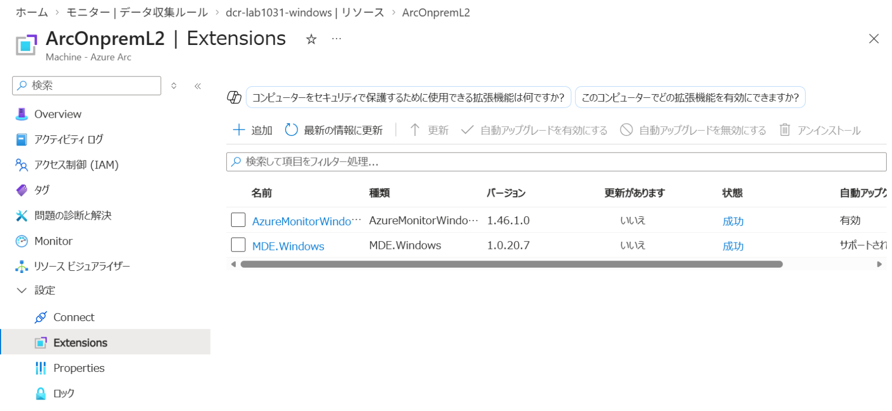

3. 「監視 → 設定 → データ収集エンドポイント」から②の `dce-arclab` を開き、「リソース → 追加」で同じ Arc サーバーを選びます。DCR にも DCE にも対象があることを確認します。DCE は AMA の設定取得先です。

   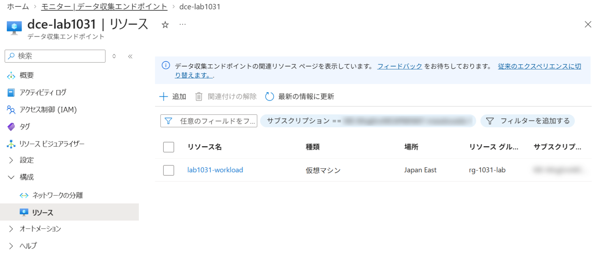

   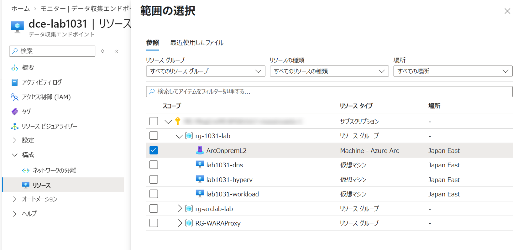

   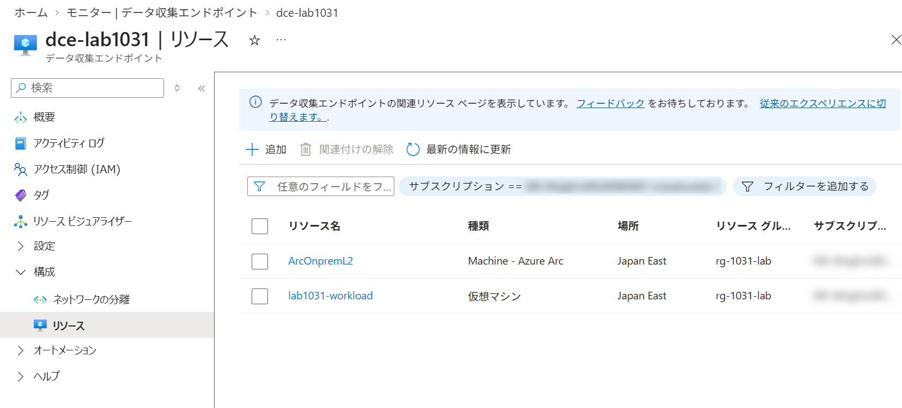

4. 閉域での収集を確認する前に、②の LAW の公開取り込みが無効、DCE の公開アクセスが無効、AMPLS の取り込みモードが `Private Only` であることを確認します。
Arc 対象サーバーで次を実行します。直接接続(Public 接続)は `False`、Proxy 待受ポートへの接続(Proxy 経由)は `True` が期待結果です。

   ```powershell
   Test-NetConnection management.azure.com -Port 443
   Test-NetConnection '10.20.0.4' -Port 3128
   ```

   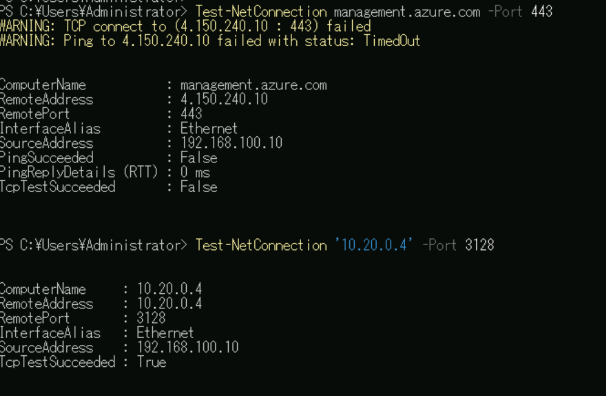

5. 対象サーバーの管理者 Windows PowerShell で、次を1回実行します。Application に検証イベントを1件書き込みます。
EventViewer で [Windows Logs -> Application ] に EventID 9001 のログが記録されます。

   ```powershell
   $ErrorActionPreference = 'Stop'
   if ($PSVersionTable.PSEdition -ne 'Desktop' -or
       $PSVersionTable.PSVersion.Major -ne 5 -or
       $PSVersionTable.PSVersion -lt [version]'5.1') {
       throw 'Use Windows PowerShell 5.1 as Administrator.'
   }
   $identity = [Security.Principal.WindowsIdentity]::GetCurrent()
   $principal = New-Object Security.Principal.WindowsPrincipal($identity)
   if (-not $principal.IsInRole([Security.Principal.WindowsBuiltInRole]::Administrator)) {
       throw 'Run Windows PowerShell as Administrator.'
   }
   $source = 'AmplsArcHandson'
   if ([Diagnostics.EventLog]::SourceExists($source) -and
       [Diagnostics.EventLog]::LogNameFromSourceName($source, '.') -ne 'Application') {
       throw 'The event source belongs to another log.'
   }
   if (-not [Diagnostics.EventLog]::SourceExists($source)) {
       New-EventLog -LogName Application -Source $source
   }
   $marker = [guid]::NewGuid().ToString()
   $utc = [datetime]::UtcNow.ToString('o')
   Write-EventLog -LogName Application -Source $source -EventId 9001 `
       -EntryType Information -Message "AmplsArcHandson marker=$marker; utc=$utc"
   [pscustomobject]@{
       Marker = $marker
       GeneratedUtc = $utc
       Computer = $env:COMPUTERNAME
       EventId = 9001
       Source = $source
   }
   ```

   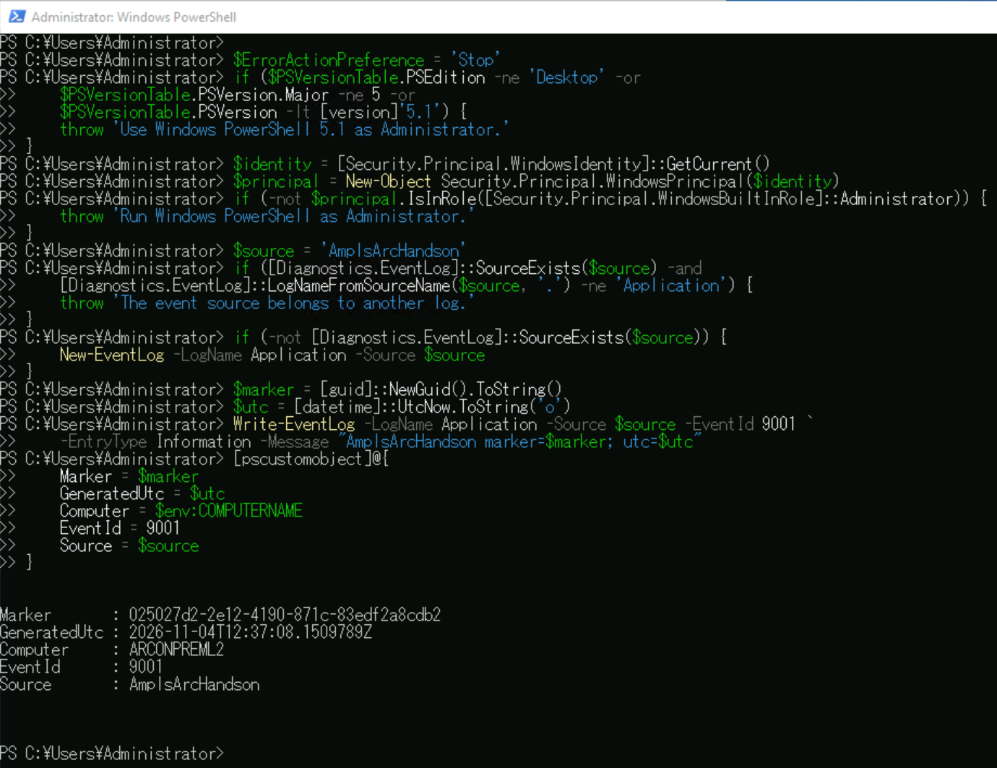

   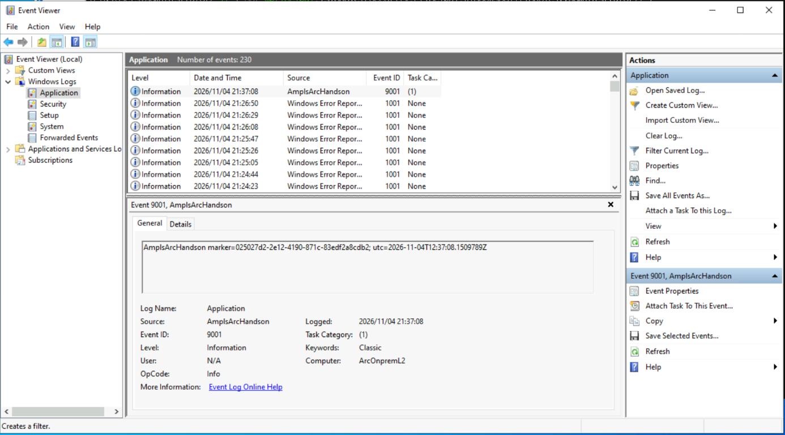

6. Portal の②の LAW →「ログ」を開き、「KQL モード」で次を実行します。表示上限は「表示 → カスタム → 100」にします。Arc の JSON ビューで取得した `id` を貼り付け、直近15分の Heartbeat を確認します。

   ```kusto
   let targetResourceId = "<Arc サーバーの JSON ビューの id>";
   Heartbeat
   | where TimeGenerated > ago(15m)
   | where _ResourceId =~ targetResourceId
   | where Category == "Azure Monitor Agent"
   | project TimeGenerated, IngestedAt=ingestion_time(), Computer, _ResourceId
   | order by TimeGenerated desc
   | take 100
   ```

7. 同じ画面で、今回のイベントの Marker と GeneratedUtc を貼り付けて実行します。検索期間は生成時刻の1分前から29分後までの30分、上限100件です。

   ```kusto
   let targetResourceId = "<Arc サーバーの JSON ビューの id>";
   let marker = "<今回の Marker>";
   let generatedUtc = todatetime("<今回の GeneratedUtc>");
   Event
   | where TimeGenerated between ((generatedUtc - 1m) .. (generatedUtc + 29m))
   | where _ResourceId =~ targetResourceId
   | where Source == "AmplsArcHandson" and EventID == 9001
   | where RenderedDescription contains marker
   | project TimeGenerated, IngestedAt=ingestion_time(), Computer, EventID,
             Source, RenderedDescription, _ResourceId
   | order by TimeGenerated desc
   | take 100
   ```

確認: 最新の Heartbeat と今回の Marker の Event が対象 Arc サーバーから到着します。Heartbeat の生成時刻と取り込み時刻も確認します。初回は15分を目安に待ちます。0件の場合は検索期間と結果を記録し、検索エラーの場合はエラーを記録して[障害調査](troubleshooting.md)へ進みます。途中で公開アクセスや通信制限を変更した場合は、変更後に生成・取り込みされたログで確認します。

閉域経路の合格には、[3-2 の DNS / TCP](#windows-dns)、[Arc のチェック](#arc-onboarding)、[②と同じ AMA の実接続確認](02-azure.md#ama-peers)も必要です。AMA の PID と実行ファイルを照合し、DCE と LAW の両接続先が AMPLS PE の対応する IP であることを確認します。接続を取得できなければ未取得として記録し、ログの到着だけで閉域経路の合格にはしません。①②の Azure VM と③の Arc サーバーの結果は、それぞれのリソース ID で区別します。

### Proxy を通った公開通信の確認

Firewall の診断設定で指定した LAW の「ログ」で次を実行します。①の L2 は WinNAT を通るため、Firewall が観測する送信元は L1 の `10.30.1.4` です。規則のソースを `*` にしていても、検索は対象送信元と直近30分に絞ります。

```kusto
let sourceIp = "10.30.1.4";
AZFWApplicationRule
| where TimeGenerated > ago(30m)
| where SourceIp == sourceIp
| project TimeGenerated, SourceIp, Fqdn, Action, Protocol
| order by TimeGenerated desc
| take 100
```

確認: Arc の認証先・管理先への Allow を確認します。

## 根拠

- [Arc PLS と制約](https://learn.microsoft.com/azure/azure-arc/servers/private-link-security)
- [Portal が生成する公式導入・登録スクリプト](https://learn.microsoft.com/azure/azure-arc/servers/onboard-portal)
- [Arc の Proxy / bypass](https://learn.microsoft.com/azure/azure-arc/servers/manage-agent-proxy-settings)
- [Arc ネットワーク要件](https://learn.microsoft.com/azure/azure-arc/servers/network-requirements)
- [Explicit Proxy](https://learn.microsoft.com/azure/firewall/explicit-proxy)
- [Firewall の DNS 設定](https://learn.microsoft.com/azure/firewall/dns-settings)
- [Premium の Application 規則と TLS 検査](https://learn.microsoft.com/azure/firewall/premium-portal#rule-configuration)
- [DCE の関連付け](https://learn.microsoft.com/azure/azure-monitor/fundamentals/private-link-vm-kubernetes)
- [AMA のネットワーク設定](https://learn.microsoft.com/azure/azure-monitor/agents/azure-monitor-agent-network-configuration)
