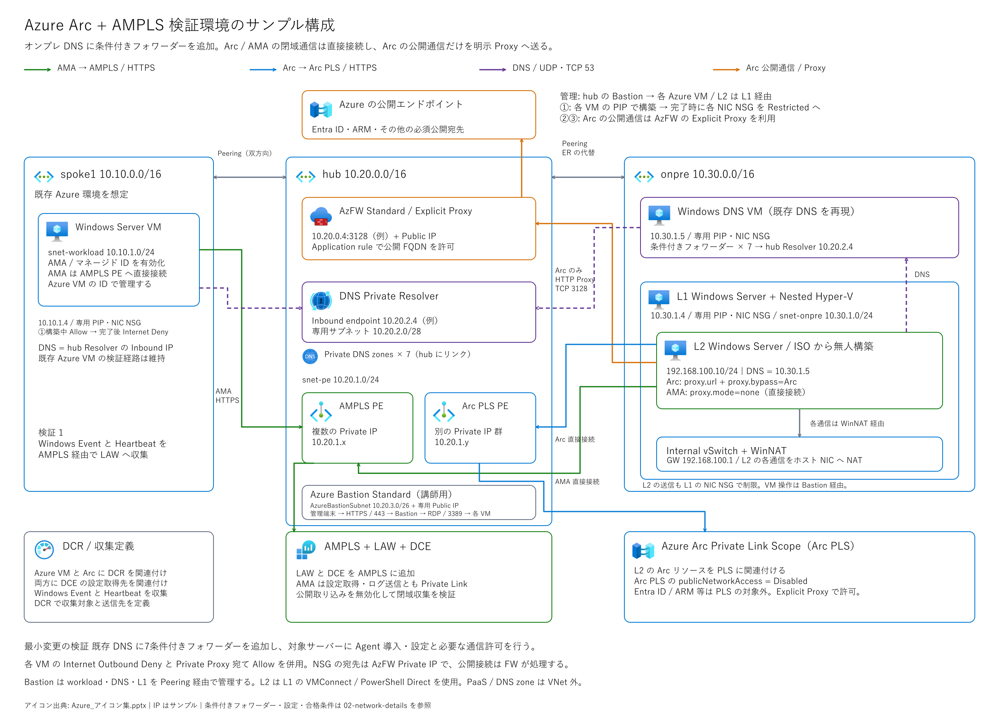
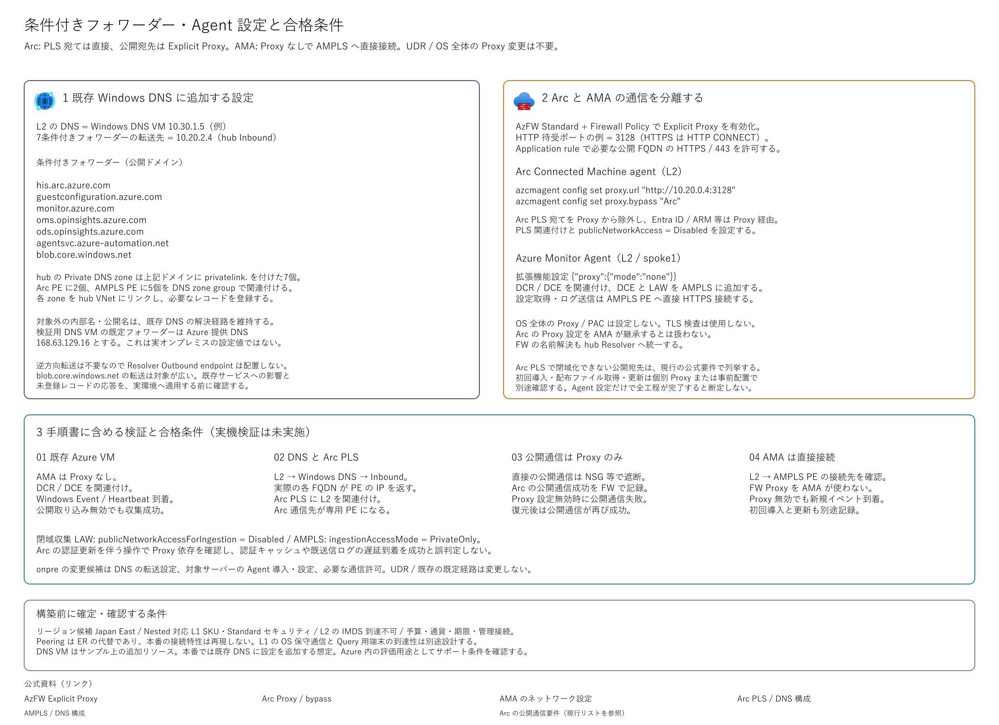

# ハンズオンの詳細仕様

[README](../README.md) / [① 検証用ラボ](01-lab.md) / [② Azure VM](02-azure.md) / [③ オンプレミス Windows](03-onpremises.md)

この資料は、ハンズオンの構成と通信の仕組みを詳しく確認するための参考資料です。実行手順は①②③に記載しています。

## 構成図

図の編集用正本は[全体構成の Excalidraw](images/01-architecture.excalidraw)と[DNS・Agent の詳細構成の Excalidraw](images/02-network-details.excalidraw)です。[全体構成の SVG](images/01-architecture.svg)と[詳細構成の SVG](images/02-network-details.svg)は派生物です。

## 対象範囲

同一テナント、同一リージョンで、Azure VM とオンプレミス Windows Server からのログ収集を検証します。①は Azure 上に疑似オンプレミス環境を作る任意の準備手順です。②は Azure VM の AMA と AMPLS、③はオンプレミスの Arc / AMA と Arc PLS / AMPLS を扱います。

複数テナント、複数リージョン、Lighthouse、Azure Arc Gateway、Microsoft Sentinel、VM Insights、性能カウンターは対象外です。Security ログや全イベントの収集も扱いません。

## 対象と役割

| 場所 | 対象 | 役割 |
|---|---|---|
| 既存 Azure 環境 | Windows VM | Azure VM のマネージド ID と AMA でログを収集する |
| hub | DNS Private Resolver の Inbound endpoint | オンプレミスからの DNS クエリを受信する |
| hub | AMPLS 用 Private Endpoint | AMA の設定取得・ログ送信先への閉域接続 |
| hub | Arc PLS 用 Private Endpoint | Arc の管理先への閉域接続。AMPLS の PE とは別 |
| hub | Azure Firewall Standard または Premium | Explicit Proxy として Arc の公開宛先への HTTPS を許可する |
| hub（講師用ラボ） | Azure Bastion Standard | Peering 経由で workload、DNS、L1 の Private IP へ RDP 接続する |
| オンプレミス | 既存 Windows DNS Server | 7ドメインの条件付きフォワーダーを追加する |
| オンプレミス | Windows Server | Connected Machine agent と AMA を導入する |
| VNet 外の論理リソース | LAW、DCE、DCR、AMPLS、Arc PLS | データ格納、収集定義、接続範囲を管理する |

LAW は Log Analytics Workspace、DCE は Data Collection Endpoint、DCR は Data Collection Rule の略です。AMPLS と Arc PLS は別のサービスです。DCR は収集するデータと送信先を定義します。②は動作確認済みの Application / Source `AmplsArcHandson` / EventID `9001` の XPath と LAW 宛先を持つ DCR を使用します。Heartbeat は AMA の稼働に伴う自動データで、収集元として選択する項目ではありません。Azure VM の基本試験 LOG-1 は新しい Heartbeat、任意試験 LOG-1E は今回生成した Event を確認します。Arc の LOG-2 は Heartbeat と今回生成した Event の両方を必須とします。

②の基本試験は、初回 Heartbeat の確認後に LAW の公開取り込みと DCE の公開アクセスを無効にし、制限反映後の新しい Heartbeat を確認します。既に制限済みの環境は公開アクセスを再び有効にせず、現在の設定を確認した UTC 時刻を基準にします。生成時刻と取り込み時刻の両方が基準時刻より後の記録を使用します。合格には、LAW 取り込み無効、DCE 公開アクセス無効、AMPLS 取り込み PrivateOnly、Restricted NSG、DNS / TCP 成功、AMA 自身の DCE / LAW 接続先がそれぞれ PE の IP、新しい Heartbeat のすべてが必要です。公開クエリは有効を維持し、閲覧には Azure の認証と RBAC 権限を必要とします。

## 通信経路と Proxy の使い分け

| 通信 | 経路 | 設定 |
|---|---|---|
| Azure VM / オンプレミス AMA の設定取得・ログ送信 | AMPLS PE へ直接 HTTPS | AMA `proxy.mode=none`、DCR / DCE の関連付け |
| Arc の HIS / Guest Configuration | Arc PLS PE へ直接 HTTPS | `proxy.bypass=Arc`、Arc PLS への関連付け |
| Arc の Entra ID / ARM 等の公開宛先 | AzFW Explicit Proxy → HTTPS の宛先 | `proxy.url=http://<FW のプライベート IP>:3128` |
| オンプレミスからの対象7ドメインの DNS | Windows DNS → Inbound endpoint → Private DNS zone | 条件付きフォワーダー、UDP / TCP 53 |
| ISO・OS 更新の取得（①の構築中） | 各 VM の専用 Public IP から直接接続 | 初期 NSG の Internet Outbound Allow |
| Arc インストーラー取得（③） | ダウンロード処理で明示的に Proxy を指定 | Restricted を維持して、Agent 設定の適用前に確認する |
| 講師の VM 操作 | 管理端末 → hub Bastion → 各 Azure VM | 端末から HTTPS / 443、Bastion から Private IP の RDP / 3389 |

②③では、Arc の必要な公開通信の出口を明示 Proxy に限定し、Arc Agent 固有の設定で通信させます。既存オンプレミスの既定経路と OS 全体の Proxy 設定は維持してください。Firewall への転送は Agent の Proxy 指定で行います。

AzFW の Explicit Proxy は Firewall Policy で有効化します。HTTP の同じ待受ポートが HTTP と HTTPS の要求を受け付け、HTTPS では CONNECT を使用します。Firewall Policy の Application rule で、必要な FQDN と宛先ポートを許可します。待受ポート `3128` と宛先 HTTPS の `443` をそれぞれ設定してください。Agent に Proxy URL を直接指定し、TLS は Agent と接続先の間で終端します。TLS 検査による証明書の置き換えは Agent の接続を失敗させるリスクがあるため、これらの通信には適用しないでください。

## DNS の仕組みと名前解決の対応表

オンプレミスの Agent は公開 FQDN を接続先に使用し、次の順に Private IP を取得します。

1. 対象サーバーが Windows DNS に問い合わせます。Windows DNS は対象7ドメインの問い合わせを条件付きフォワーダーで Resolver の Inbound endpoint へ転送します。
2. Resolver が公開 FQDN の CNAME と、hub VNet にリンクされた Private DNS zone のレコードを解決します。
3. 対象サーバーが応答された PE の Private IP へ TCP 443 で接続します。DNS の問い合わせと Agent の HTTPS 通信は別の通信です。

Windows DNS の条件付きフォワーダーには、次の表の公開ドメインを指定してください。Agent の接続先を `privatelink` 付きの FQDN に置き換える必要はありません。

| 条件付きフォワーダー | hub にリンクする Private DNS zone | 対象 |
|---|---|---|
| `his.arc.azure.com` | `privatelink.his.arc.azure.com` | Arc PLS |
| `guestconfiguration.azure.com` | `privatelink.guestconfiguration.azure.com` | Arc PLS |
| `monitor.azure.com` | `privatelink.monitor.azure.com` | AMPLS / DCE |
| `oms.opinsights.azure.com` | `privatelink.oms.opinsights.azure.com` | AMPLS |
| `ods.opinsights.azure.com` | `privatelink.ods.opinsights.azure.com` | AMPLS |
| `agentsvc.azure-automation.net` | `privatelink.agentsvc.azure-automation.net` | AMPLS |
| `blob.core.windows.net` | `privatelink.blob.core.windows.net` | AMPLS に必要な対象レコード |

AMPLS の PE は複数の IP を使用します。PE の DNS 構成画面に表示された実際の FQDN と IP をすべて記録し、各 FQDN の応答を検証してください。`blob.core.windows.net` の転送では、Private DNS zone に登録された対象のレコードを PE の IP に解決します。転送対象に既存の別 Blob アカウントも含まれるため、それらの名前解決と利用状況を変更前後で比較してください。同名の条件付きフォワーダーが既にある場合は、その転送先と複製範囲も変更の影響に含まれます。

Inbound endpoint が配置された hub VNet に zone をリンクします。このサンプルの転送方向はオンプレミスから Azure です。Resolver は Inbound endpoint を使用します。
①の workload VM は Resolver の Inbound endpoint を直接 DNS サーバーに指定します。疑似オンプレミスの L1 / L2 は Windows DNS を使用し、③で設定する条件付きフォワーダーを経由します。

## 設計上の制約

### AMPLS と DNS 解決範囲

同じ DNS 解決範囲には、原則として単一の AMPLS を使用します。既存 AMPLS がある場合は、その scope に対象の LAW / DCE を追加する構成を検討します。同じ解決範囲への別 AMPLS の追加は、既存監視の名前解決を変える可能性があります。ラボ用 RG を分けるだけでは、共有する DNS の影響を分離できません。

### Arc Private Link の適用範囲

③は、同じ VNet / DNS 解決範囲の Arc サーバーがすべて Private Link を使用する構成です。Private Link を使用しない Arc サーバーも混在する場合は、共有する DNS の応答がそれらの通信にも影響します。[Arc Private Link の制約](https://learn.microsoft.com/azure/azure-arc/servers/private-link-security#restrictions-and-limitations)に従って構成を決めてください。

### 収集リソースのリージョン

AMPLS の location はグローバルです。DCE の設定取得先は監視対象と同じリージョン、DCR の送信先 LAW も同じリージョンにそろえます。このハンズオンでは Arc PLS と登録する Arc サーバーも同じリージョンに配置します。

### 既存の監視と自動管理

既存 AMA / Arc、DCR / DCE の関連付け、マネージド ID を使用している環境では、その設定と利用先を維持する必要があります。Azure Policy や Defender、Arc 拡張機能の自動配布、SQL Server の自動登録によって、ハンズオン以外の設定や課金対象が追加される場合もあります。

## 疑似環境について

疑似環境では Azure VM 内に Hyper-V を構成し、その L2 ゲストだけを Arc に登録します。
L1 ホストは Azure VM として管理します。L2 は Internal vSwitch と WinNAT を使用し、Azure / Azure Local IMDS への接続を遮断します。
Azure VM の IMDS 通信は既定では NSG の制限対象外です。IMDS の許可を目的とする NSG 規則は追加しません。`AzurePlatformIMDS` タグは既定の通信を拒否する場合に使用するタグであり、`Allow` 規則には使用できません。L2 の IMDS 遮断は L2 内の Windows Firewall で行い、L1 の IMDS 通信は維持します。
この構成は Azure 内の評価用です。本番環境への適用時は、実際のサーバーと接続方式に合わせて設計してください。

講師用の管理接続には hub の `AzureBastionSubnet`（`10.20.3.0/26`）へ Bastion Standard をデプロイします。ブラウザーから3台の Azure VM を操作し、ファイル転送には有効化済みのネイティブ RDP 接続を使います。L2 は L1 の VMConnect / PowerShell Direct を使用してください。Firewall・Bastion・3台の VM が、それぞれ専用 Public IP を持ちます。VM の管理接続は Private IP 経由に統一します。
既存環境で②③を実施する場合は、既存の承認済み管理接続を使用してください。

## ①の構築用通信と②③の演習用通信

| フェーズ | 3台の NIC NSG | 主な作業 |
|---|---|---|
| Build | Internet 宛て Allow、Internet からの着信 Deny、RDP は Bastion を許可 | ISO 取得、L2 の無人構築、OS 更新・アクティベーション |
| Restricted | Internet 宛て Deny、DNS・PE・Proxy・必要な Azure プラットフォーム通信を許可 | ②③で登録・収集と閉域経路を検証 |

①の最後に3台の `LabInternetOutbound` 規則を Allow から Deny に切り替えます。Public IP と NSG は NIC に関連付けたまま維持してください。L2 の通信も L1 の WinNAT を通るため、L1 の NSG で制限されます。Bastion と Azure Firewall 自身には、この VM 用 Internet Deny を適用しません。

NSG が判定するのは VM が送信するパケットの宛先です。Arc Agent が `10.20.0.4:3128` を Proxy に指定した場合、VM の NSG ではプライベート宛ての通信として評価されます。AzFW が Entra ID 等へ接続する処理は Firewall Policy で許可します。直接の公開接続だけを遮断し、Private Endpoint と明示 Proxy の経路を維持してください。

NSG はステートフルです。規則変更後も既存フローが続く場合があるため、構築中の通信を終了し、新しい接続で Restricted の成否を確認します。AMA / VM 拡張機能の初回配布・更新は、ログの稼働通信と分けて検証します。配布用の例外が必要な場合は、実際の宛先、対象 VM、期間を承認し、例外終了後の Restricted 状態で新規ログの到着を判定してください。

## 最小変更として評価する項目

1. 既存 Windows DNS への7条件付きフォワーダー追加。
2. Portal が生成する公式スクリプトによる対象サーバーへの Arc 導入・登録と、公式 `azcmagent` コマンドによる Arc 固有の Proxy / bypass 設定。登録前に bypass を `Arc` に設定し、OS 全体の Proxy は維持する。
3. 対象サーバーへの AMA 拡張機能導入、直接接続の指定、DCR / DCE 関連付け。
4. DNS、PE、Proxy への到達を許可する既存 Firewall 等の設定。手順③のソース `*` は専用ラボの例であり、共有 Firewall は対象の送信元に限定する。既存通信の直接遮断と閉域経路の試験条件は維持する。
5. Azure 側の AMPLS、Arc PLS、PE、DNS zone、収集リソースの準備。

「最小変更」は実機検証で確定する結果です。既存の監視、DNS、更新経路によって追加の調整が必要になる場合があります。

## 根拠

- [Azure Firewall Explicit Proxy](https://learn.microsoft.com/azure/firewall/explicit-proxy)
- [Arc の Proxy / bypass](https://learn.microsoft.com/azure/azure-arc/servers/manage-agent-proxy-settings)
- [Arc Private Link](https://learn.microsoft.com/azure/azure-arc/servers/private-link-security)
- [AMA のネットワークと Proxy](https://learn.microsoft.com/azure/azure-monitor/agents/azure-monitor-agent-network-configuration)
- [AMPLS の設計](https://learn.microsoft.com/azure/azure-monitor/fundamentals/private-link-design)
- [Bastion と VNet Peering](https://learn.microsoft.com/azure/bastion/vnet-peering)
- [Bastion のネイティブクライアント](https://learn.microsoft.com/azure/bastion/native-client)
- [NSG の評価順序とステートフル処理](https://learn.microsoft.com/azure/virtual-network/network-security-groups-overview)
